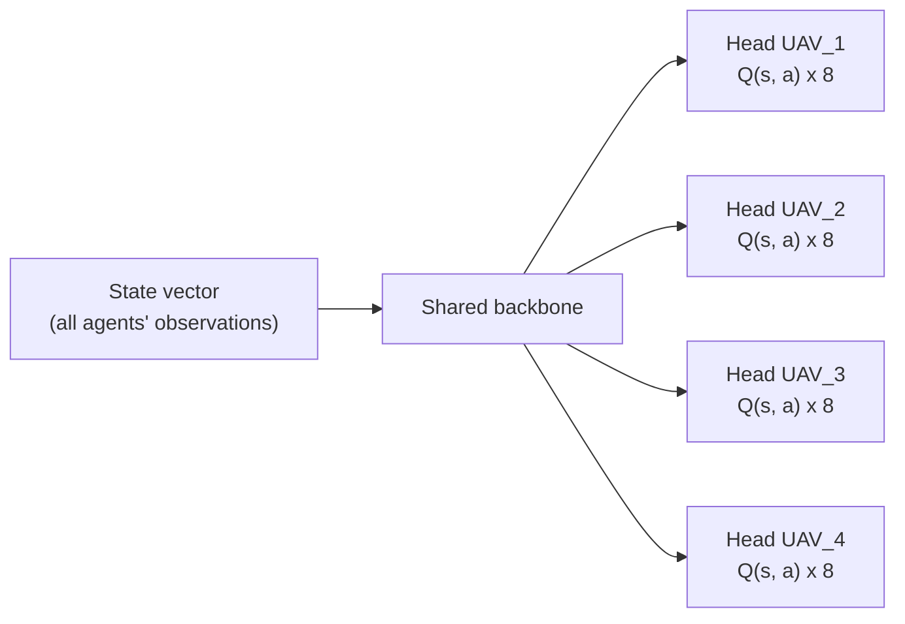
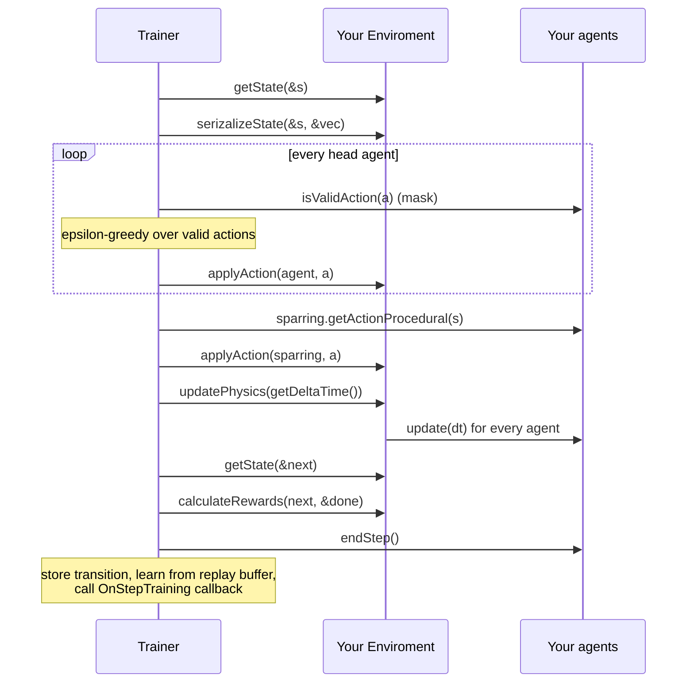
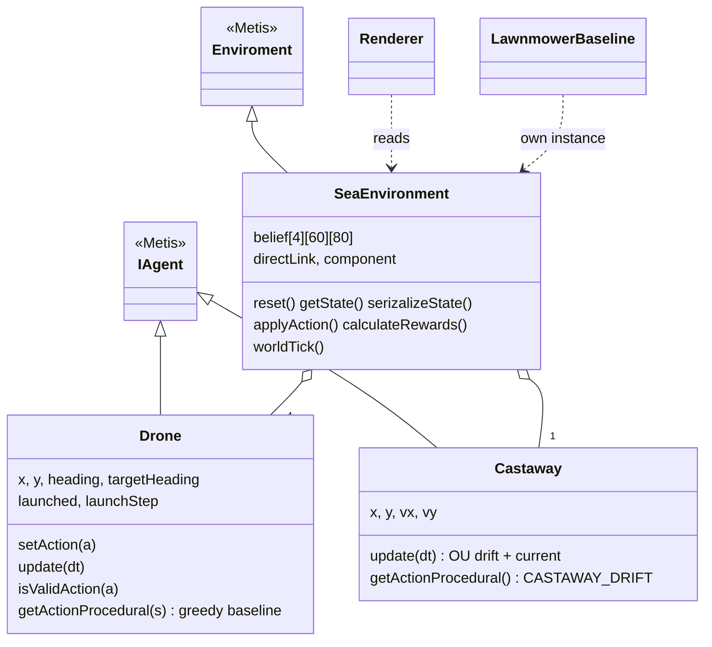

# Metis-Core Multi-Head Tutorial — with SARSwarm as a worked example

This tutorial teaches you how to train **several cooperating agents with one neural network** using the
multi-head API of **Metis-Core** (v0.4.x). The first half explains the API with a minimal skeleton you can copy;
the second half dissects **SARSwarm**, a search-and-rescue swarm of 4 drones, to show how a real project
maps onto that API.

> Audience: C++ programmers who know the basics of reinforcement learning (state, action, reward, episode).
> You do not need to know LibTorch: Metis-Core hides it.

---

## Table of contents
1. [What "multi-head" means](#1-what-multi-head-means)
2. [The five classes you will touch](#2-the-five-classes-you-will-touch)
3. [The step contract: who calls what, and when](#3-the-step-contract-who-calls-what-and-when)
4. [Minimal skeleton](#4-minimal-skeleton)
5. [Training, saving, loading, inference](#5-training-saving-loading-inference)
6. [SARSwarm: the problem](#6-sarswarm-the-problem)
7. [SARSwarm: class map](#7-sarswarm-class-map)
8. [SARSwarm: how the world is represented](#8-sarswarm-how-the-world-is-represented)
9. [SARSwarm: the observation (151 inputs)](#9-sarswarm-the-observation-151-inputs)
10. [SARSwarm: rewards per head](#10-sarswarm-rewards-per-head)
11. [SARSwarm: evaluation against a baseline](#11-sarswarm-evaluation-against-a-baseline)
12. [Pitfalls and checklist](#12-pitfalls-and-checklist)

---

## 1. What "multi-head" means

A multi-head network has **one shared trunk (backbone)** and **one output head per agent**:



- Every head outputs the Q-values of **its** agent's actions. Each agent picks its action from its own head.
- Every head receives **its own reward** (`calculateRewards` returns one reward per head).
- The backbone is trained by all heads, so the agents share what they learn about the world.
- Training is **centralized** (one network, one replay buffer, all rewards visible). Whether *execution* is
  decentralized depends on what you put in the input: in SARSwarm each drone's block only contains what that
  drone could know through its radio (see section 9).

When to use it: a fixed number of cooperating agents, each with a discrete action set, that must coordinate.
Classic examples: a drone swarm, units of a squad, the joints of a robot.

---

## 2. The five classes you will touch

| Class | Header | Your job |
|---|---|---|
| `Metis::IAgent` | `IAgent.h` | Subclass it once per kind of agent (drone, enemy...). Implements physics and action masks. |
| `Metis::Enviroment` | `Enviroment.h` | Subclass it once. Owns the world, builds the state, applies actions, computes rewards. *(Note the spelling: `Enviroment`.)* |
| `Metis::State` | `State.h` | Container passed around by the trainer. You copy **your own struct** into it (max 1000 bytes). |
| `Metis::MultiHeadBrainBuilder` | `MultiHeadBrainBuilder.h` | Builds the network: one `addHead` per agent. |
| `Metis::MultiHeadsAgentTrainerDQN` | `MultiHeadsAgentTrainerDQN.h` | Runs the DQN training loop and calls your callbacks. |

`MultiHeadAgent` (returned by the builder) is the trained "brain": you save/load it and ask it for actions.

### 2.1 `IAgent` — methods to override

| Method | Called by | Meaning |
|---|---|---|
| `int update(double dt)` | `Enviroment::updatePhysics` | Advance this agent's physics by `dt`. |
| `bool isValidAction(int a)` | trainer (and you) | Action mask. Invalid actions are never chosen (neither random nor greedy). |
| `int getActionProcedural(State&)` | trainer, for the *sparring* agent | Scripted behaviour (enemy, target, baseline heuristic). |
| `void endStep()` | trainer, after rewards | Clear per-step flags. |
| `setID(int)` / `getID()` | you, in the constructor | Unique ID inside the environment. |

### 2.2 `Enviroment` — pure virtual methods

```cpp
virtual void  reset() = 0;                                         // new episode
virtual void  getState(State* pState) = 0;                         // copy your struct into State
virtual void  serizalizeState(void* state, std::vector<float>* v) = 0; // State -> network input floats
virtual void  applyAction(IAgent* pAgent, int actionId) = 0;       // store the chosen action
virtual float calculateReward(State& s, int* iDone) = 0;           // single-head DQN only (return 0 here)
virtual std::vector<TMULTIHEAD> calculateRewards(State& s, int* iDone) = 0; // ONE reward per head
```

Non-virtual helpers you get for free: `addAgent(IAgent*)`, `getAgentFromID(int)`, `getNumberAgents()`,
`updatePhysics(dt)` (calls `update(dt)` on every registered agent), and virtual `getDeltaTime()`.

`iDone` convention: `0` = episode continues, `1` = success, `-1` = failure.

### 2.3 `TMULTIHEAD` — the per-head reward

```cpp
Metis::TMULTIHEAD h((char*)"UAV_1"); // MUST be the same name given to addHead(...)
h.reward = 0.42f;
```
Rewards are matched to heads **by name**, so keep head names and reward names identical.

---

## 3. The step contract: who calls what, and when

One training step of `MultiHeadsAgentTrainerDQN` follows this order (the same order SARSwarm uses in its
Play loop, `playTick()` in `main.cpp`):



Key consequences:
- **`applyAction` should only store the decision** (e.g. a target heading). The movement happens in `update`.
- `updatePhysics` is **not virtual**: it only loops over the agents. If your world needs a global update
  *after* all agents moved (sensors, communications, collisions...), trigger it from the next `getState`.
  SARSwarm does this with a "dirty" flag (section 8.4).
- `serizalizeState` must read **only the struct stored inside the `State`**, never the live world. The
  replay buffer replays old states much later; reading live positions would mix past and present.

---

## 4. Minimal skeleton

A complete, compilable shape for *N* cooperative agents with 4 actions each. Replace the bodies with your
logic.

```cpp
#include "METIS-Core.h"
#include <vector>

constexpr int N_AGENTS  = 3;
constexpr int N_ACTIONS = 4;          // e.g. up, down, left, right
constexpr int OBS_PER_AGENT = 6;
constexpr int NET_INPUTS = N_AGENTS * OBS_PER_AGENT;

// 1) Your state struct: everything the network (and the reward) needs. Must fit in 1000 bytes.
struct MyState
{
    float obs[N_AGENTS][OBS_PER_AGENT];
    int   step;
};
static_assert(sizeof(MyState) < MAX_SIZE_STATE, "state too big");

// 2) An agent
class Worker : public Metis::IAgent
{
public:
    Worker(int id, const char* n) : name(n) { setID(id); }
    std::string name;
    float x = 0, y = 0;
    int   pending = -1;

    int  update(double dt) override { /* move using 'pending' */ return 0; }
    bool isValidAction(int a) override { return a >= 0 && a < N_ACTIONS; }
    int  getActionProcedural(Metis::State&) override { return 0; }
    void endStep() override {}
};

// 3) The environment
class MyWorld : public Metis::Enviroment
{
public:
    Worker* w[N_AGENTS];
    MyState s{};

    void bind(Worker* ws[N_AGENTS]) { for (int i = 0; i < N_AGENTS; i++) { w[i] = ws[i]; addAgent(w[i]); } }

    void reset() override { s = MyState{}; /* place agents, targets... */ }

    void getState(Metis::State* p) override
    {
        /* fill s.obs from the world */
        p->copyState(&s, sizeof(MyState));
    }

    void serizalizeState(void* state, std::vector<float>* v) override
    {
        MyState* st = (MyState*)((Metis::State*)state)->getUserState(); // ONLY the stored struct
        v->clear();
        for (int i = 0; i < N_AGENTS; i++)
            for (int k = 0; k < OBS_PER_AGENT; k++)
                v->push_back(st->obs[i][k]);
    }

    void applyAction(Metis::IAgent* a, int act) override { ((Worker*)a)->pending = act; }

    float calculateReward(Metis::State&, int* done) override { *done = 0; return 0.0f; }

    std::vector<Metis::TMULTIHEAD> calculateRewards(Metis::State& st, int* done) override
    {
        std::vector<Metis::TMULTIHEAD> r;
        *done = 0;                                  // 1 success, -1 failure
        for (int i = 0; i < N_AGENTS; i++)
        {
            Metis::TMULTIHEAD h((char*)w[i]->name.c_str());
            h.reward = 0.0f;                        // your per-agent reward
            r.push_back(h);
        }
        return r;
    }
    float getDeltaTime() override { return 1.0f; }
};

// 4) Callbacks
static void onStep(void*, Metis::TMULTIHEADAGENTMETRICS* m)
{
    // m->episode, m->step, m->_headMetric["W1"].reward / .action, m->_meanTotalLoss ...
    // m->bForceStopTraining = true;   // to stop training gracefully
}
static void onEpisode(void*, Metis::TMULTIHEADAGENTMETRICS* m) { /* log, save best model */ }

int main()
{
    const char* names[N_AGENTS] = { "W1", "W2", "W3" };
    Worker* ws[N_AGENTS];
    for (int i = 0; i < N_AGENTS; i++) ws[i] = new Worker(i, names[i]);

    Metis::MultiHeadBrainBuilder b;
    for (int i = 0; i < N_AGENTS; i++)
        b.addHead(ws[i]->name, ws[i], N_ACTIONS);   // head name == reward name
    Metis::MultiHeadAgent* brain = b.setNumberInputsOutputs(NET_INPUTS)
                                    .useGPU(Metis::isCUDAavailable())
                                    .build();

    MyWorld world;
    world.bind(ws);
    world.reset();

    Metis::MultiHeadsAgentTrainerDQN trainer;
    trainer.setCallbackPerStep(onStep);
    trainer.setCallbackEndEpisode(onEpisode);
    trainer.training(&world, brain /*, sparringAgent (optional) */);

    brain->saveIAModel((char*)"model.ai");
}
```

### Agents with different action counts
`addHead(name, agent, maxActions)` uses the **maximum** action count for every head. If one agent has fewer
actions, return `false` from its `isValidAction` for the extra ones.

### The sparring agent
`training(env, brain, sparring)` accepts one optional agent that is **not** controlled by the network. Each step
the trainer calls `sparring->getActionProcedural(state)` and passes the result to `applyAction`. Use it for an
enemy, a moving target, or anything scripted. Give it an ID outside the head range and its own action constant.

---

## 5. Training, saving, loading, inference

```cpp
// save (typically in OnEndEpisode, when your success metric improves)
brain->saveIAModel((char*)"best.ai");

// continue training or play: build the SAME network (same heads, same NET_INPUTS), then
int res = brain->loadIAModel((char*)"best.ai", useGPU);

// inference, one action per agent
Metis::State st;
env.getState(&st);
env.serizalizeState(&st, &st._stateVector);     // fill the float vector before asking the brain
for (Worker* w : workers)
    env.applyAction(w, brain->getBestAction(w, st));
env.updatePhysics(env.getDeltaTime());
```

- Changing `NET_INPUTS`, the number of heads or actions **invalidates** saved models.
- `getBestAction(agent, state)` respects `isValidAction`.
- `METRICS_X_EPISODES` (50) is the window Metis uses for `countSuccesX50episodes`.

---

## 6. SARSwarm: the problem

4 UAVs take off from a mothership and search a 4 × 3 km sea area for a castaway who drifts with a random
current. The castaway dies after 30 min (1800 steps of 1 s). The drones:
- fly at 20 m/s, turn at 30°/s, and choose one of **8 headings** every second;
- see the castaway if it is within 150 m (85 % chance per step);
- talk by radio up to 1.2 km, multi-hop;
- share a **heat map** of the areas already scanned, but only with drones they can reach by radio.

One network, **4 heads = 4 drones**, 8 actions per head, 151 inputs.

---

## 7. SARSwarm: class map



| File | Role |
|---|---|
| `SimConfig.h` | **All** constants: world size, speeds, radio range, reward weights, `NET_INPUTS`. Start reading here. |
| `Drone.h/.cpp` | One head. Physics with limited turn rate, border mask, greedy heuristic. |
| `Castaway.h/.cpp` | The sparring agent. Random drift (Ornstein-Uhlenbeck) + sea current; ignores its action. |
| `SeaEnvironment.h/.cpp` | The world: heat maps, radio graph, detection, observation, rewards. |
| `LawnmowerBaseline.*` | Classic parallel-track search simulated in the same environment, for comparison. |
| `Renderer.*` | raylib drawing only. Never changes the simulation. |
| `main.cpp` | Menu, network construction, training callbacks, Play loop. |

### 7.1 Building the network (`main.cpp`)

```cpp
const char* names[NUM_DRONES] = { "UAV_1", "UAV_2", "UAV_3", "UAV_4" };
for (int i = 0; i < NUM_DRONES; i++)
    app.drones[i] = new Drone(i, names[i]);            // IDs 0..3
app.castaway = new Castaway();                           // ID 4 (CASTAWAY_ID)

Metis::MultiHeadBrainBuilder builder;
for (int i = 0; i < NUM_DRONES; i++)
    builder.addHead(app.drones[i]->name, app.drones[i], NUM_DRONE_ACTIONS);
app.brain = builder.setNumberInputsOutputs(NET_INPUTS).useGPU(app.gpu).build();

app.env = new SeaEnvironment();
app.env->bindAgents(app.drones, app.castaway);           // addAgent x 5
...
trainer.training(app.env, app.brain, app.castaway);      // castaway = sparring agent
```

### 7.2 Actions (`Drone`)

```cpp
enum DRONE_ACTIONS { GO_E = 0, GO_SE, GO_S, GO_SW, GO_W, GO_NW, GO_N, GO_NE, NUM_DRONE_ACTIONS };
```
Action *k* means "desired heading k·45°" (screen coordinates: 0 = East, y grows downwards).
- `applyAction` → `Drone::setAction` only stores `targetHeading`.
- `Drone::update` turns towards it at 30°/s max and moves forward at 20 m/s.
- `Drone::isValidAction` projects the heading 150 m ahead and **masks headings that would leave the world**.
  This removes a whole class of useless exploration from training.
- Drones start on the ship deck and take off one every 8 s (`launched`, `launchStep`).

---

## 8. SARSwarm: how the world is represented

### 8.1 The grid
The sea is a grid of **80 × 60 cells of 50 m**. Positions are continuous floats in meters; the grid is only used
for the heat maps.

### 8.2 Heat maps ("T mark")
```cpp
float belief[NUM_DRONES][GRID_H][GRID_W];   // what EACH drone knows, 0 = never/long ago, 1 = just scanned
float _teamMap[GRID_H][GRID_W];             // union of all drones, used ONLY for rewards and metrics
```
- When a cell enters a drone's 150 m footprint, that drone writes `1.0` on **its own** map.
- Every step all maps cool down by `1/600` → a scanned cell goes back to black after 10 min. This models the
  fact that a castaway may drift into an area that was empty some minutes ago.
- Rendering: white = just scanned, red = medium, black = cold (worth searching).

Why one map per drone instead of a global one? Because a drone that lost radio contact must **not** know what
the others scanned. The network then has to learn that losing the link has a cost.

### 8.3 Radio links and islands (`updateComms`, `mergeMaps`)
```cpp
float linkDist[4][4];   bool directLink[4][4];   // link if distance <= 1200 m
int   component[4];     int  componentSize[4];   // connected island of each drone (BFS)
```
1. Direct links between every pair closer than `COMM_RANGE`.
2. A **BFS** groups drones into islands: messages hop from drone to drone (mesh network), so A–B–C are one
   island even if A and C are 2 km apart.
3. Inside each island all maps are merged with `max` (the most recent mark wins).
4. `lastKnownX/Y[i][j]` is only refreshed when *i* and *j* share an island.
5. `disconnectedSteps[i]` counts the consecutive seconds a drone spends outside the full network.

Renderer: green line = link, **yellow blinking** = above 80 % of the range, red warning = isolated.

### 8.4 The world tick (dirty-flag pattern)
`Enviroment::updatePhysics` only calls `update(dt)` on each agent. The global work happens once per step:

```cpp
int Drone::update(double dt) { /* move */ env->markDirty(); return 0; }

void SeaEnvironment::getState(Metis::State* p)
{
    if (_dirty) worldTick();             // runs once, after ALL agents moved
    p->copyState(&_obs, sizeof(TSARSTATE));
}

void SeaEnvironment::worldTick()
{
    _step++;
    decayMaps();        // 1. cool down
    scanAndGain();      // 2. each drone marks its footprint, exploration gain on the TEAM map
    updateComms();      // 3. links, islands, disconnected time
    mergeMaps();        // 4. share maps inside each island
    detectCastaway();   // 5. 150 m, p = 0.85
    computePenalties(); // 6. overlap and communication penalties
    buildObservation(_obs);
}
```
Reuse this pattern whenever agents interact (sensors, collisions, communications).

### 8.5 The state struct stored in the replay buffer
```cpp
typedef struct _sarState
{
    float obs[NUM_DRONES][OBS_PER_DRONE]; // the ALREADY computed input of each head
    float timeNorm;                       // step / MAX_STEPS
    float currentX, currentY;             // sea current / 0.6
    int   step;
    int   detectedBy;                     // -1 if not found
    float castawayX, castawayY;           // ground truth: debugging only, NOT a network input
} TSARSTATE;                              // 620 bytes  (< 1000)
static_assert(sizeof(TSARSTATE) < MAX_SIZE_STATE, "...");
```
The observation is computed **once** in `buildObservation`, and `serizalizeState` just copies it:

```cpp
void SeaEnvironment::serizalizeState(void* state, std::vector<float>* v)
{
    TSARSTATE* s = (TSARSTATE*)((Metis::State*)state)->getUserState();
    v->clear();
    for (int i = 0; i < NUM_DRONES; i++)
        for (int k = 0; k < OBS_PER_DRONE; k++) v->push_back(s->obs[i][k]);
    v->push_back(s->timeNorm);  v->push_back(s->currentX);  v->push_back(s->currentY);
}
```
You cannot store the 4 × 80 × 60 maps in 1000 bytes — so they are **summarized** into the observation.

---

## 9. SARSwarm: the observation (151 inputs)

`4 blocks × 37 + 3 globals = 151`. Block *i* describes the world **as drone *i* knows it**:

| Index in block | Count | Content | Normalization |
|---|---|---|---|
| 0–1 | 2 | Own position x, y | / 4000, / 3000 |
| 2–3 | 2 | Own heading | cos, sin |
| 4–11 | 8 | Coldness, near ring 0–600 m, one value per action direction | sum(1−heat) / expected cells |
| 12–19 | 8 | Coldness, far ring 600–1800 m | same |
| 20–34 | 15 | 3 teammates × (dx, dy, cos h, sin h, connected), **zeros if not in the same island** | dx/4000, dy/3000 |
| 35 | 1 | Isolated (no direct link) | 0/1 |
| 36 | 1 | Time outside the full network | /120 s, saturates at 1 |

Globals: episode time and sea current (vx, vy).

Design notes worth copying:
- **Sectors aligned with actions.** Sector *k* covers ±22.5° around heading *k*, so "input 4+k is high" maps
  directly to "action k is promising". This makes learning much easier than giving raw maps.
- **Angles as cos/sin** avoid the 359° → 0° jump.
- **Unknown = 0.** A teammate out of radio range is all zeros plus `connected = 0`: the network learns that
  zeros mean "no information".
- **Markov state.** The communication penalty grows with disconnected time, so that time is also an input;
  otherwise the reward would depend on something the network cannot see.
- **Sectors outside the map** come out low (no cells to sum), so the border looks "hot" (not worth visiting).

Coldness per sector (`SeaEnvironment::buildObservation`):
```cpp
float ang = atan2f(py, px);                                // cell direction from the drone
int k = (int)floorf(ang / sectorWidth + 0.5f);             // nearest action direction
k = ((k % NUM_SECTORS) + NUM_SECTORS) % NUM_SECTORS;
float cold = 1.0f - belief[i][cy][cx];                     // drone i's OWN map
if (dist <= RING1_RADIUS) cold1[k] += cold; else cold2[k] += cold;
...
o[OBS_SECTORS + k]               = std::min(1.0f, cold1[k] / RING1_CELLS);
o[OBS_SECTORS + NUM_SECTORS + k] = std::min(1.0f, cold2[k] / RING2_CELLS);
```

---

## 10. SARSwarm: rewards per head

All weights live in `SimConfig.h`. Per step, for each launched drone *i*:

| Term | Formula | Purpose |
|---|---|---|
| Useful exploration | Σ(1−heat) of scanned cells on the **team** map / 3 × shareFactor | Pay only for genuinely new area; an isolated drone shares nothing, so it earns nothing. |
| Team term | +0.25 × mean exploration of the teammates | Cooperation signal. Positive part normalized to [0, 1]. |
| Re-scan | −0.5 × Σ heat of cells **entering** the sensor / 3 | Linear: re-scanning a white cell costs more than an almost black one. |
| Overlap | up to −0.3 per connected teammate closer than 300 m | Do not fly on top of each other. |
| Communications | severity × (−0.2 → −1.0 over 120 s) | severity = 1 alone, 2/3 in a pair, 1/3 in a trio. Splitting is always worse than staying together. |
| Yellow zone | up to −0.2 | Connected but weakest-link margin almost gone. |
| Time / border | −0.01 / −0.3 | Urgency; do not bump the world edge. |
| Terminal | +5 finder, +3 others, −3 all if the castaway dies | Mission outcome. |

Two principles behind this design:
- **Centralized reward, decentralized input.** The reward is measured on the global team map (training sees
  everything), while each head's input only contains what its drone knows. This is the usual CTDE
  (centralized training, decentralized execution) recipe.
- **Check rewards with numbers before training.** Simulate scripted policies (random, greedy, lawnmower) and
  verify that the policy you want really gets the highest return. Several SARSwarm reward bugs were found this
  way before wasting hours of training.

---

## 11. SARSwarm: evaluation against a baseline

A good return curve does not prove a good policy. SARSwarm measures mission metrics every episode:
- **Time to contact** (seconds; failure counts as 1800).
- **Redundancy %**: share of cells entering a sensor that the team scanned less than 5 min before.

They are compared with:
- **Greedy heuristic** — `Drone::getActionProcedural`: fly to the coldest sector, avoid breaking the link
  (press `H` in Play).
- **Lawnmower** — `LawnmowerBaseline::compute`: each drone sweeps a 1 km strip in 4 tracks 250 m apart. It
  creates its **own** environment, drones and castaway instances and drives `targetHeading` directly. Results
  are cached in `lawnmower_baseline.txt` and drawn as a white dashed line with a 25–75 % band.

| Policy | Success | Mean time | Redundancy |
|---|---|---|---|
| Random (≈ untrained) | 66 % | 1178 s | 65.5 % |
| Greedy | 96 % | 381 s | 29.3 % |
| Lawnmower | 99 % | ~410–430 s | 23.4 % |

(About 16–17 points of the lawnmower redundancy come from the 50 m overlap between tracks; the rest come from
the 4 drones flying out of the ship along the same corridor.)

Reusing the environment class for baselines is cheap and makes comparisons fair: same current, same drift,
same detection model.

---

## 12. Pitfalls and checklist

**Pitfalls**
- Head names in `addHead` and in `TMULTIHEAD` must match exactly.
- `State` holds at most 1000 bytes (`copyState` throws otherwise). Add a `static_assert`.
- Never read the live world in `serizalizeState`; read only the stored struct.
- Call `serizalizeState(&st, &st._stateVector)` before `getBestAction` at inference time.
- Use float division for normalizations (`(float)step / MAX_STEPS`).
- A network input must explain every reward term that depends on history (e.g. disconnected time).
- Use `isValidAction` to mask impossible or suicidal actions instead of punishing them.
- Rendering every step is slow: draw every N steps and keep the window responsive with a time-based redraw.
- Any change to inputs, heads or actions → retrain from scratch.

**Checklist for a new multi-head project**
1. Write `SimConfig.h` with every constant and `NET_INPUTS` computed from them.
2. One `IAgent` subclass per agent type; `setID` in the constructor; movement in `update`.
3. One `Enviroment` subclass: `reset`, `getState` (+ world tick), `serizalizeState`, `applyAction`,
   `calculateRewards`.
4. A state struct < 1000 bytes with the observation already computed.
5. Build the brain: one `addHead` per agent, `setNumberInputsOutputs`, `useGPU`, `build`.
6. Scripted baselines in the same environment; verify the rewards numerically.
7. Train with callbacks: log, save the best model, allow a graceful stop with `bForceStopTraining`.
8. Play mode: `loadIAModel` + `getBestAction`, and compare against the baselines.
