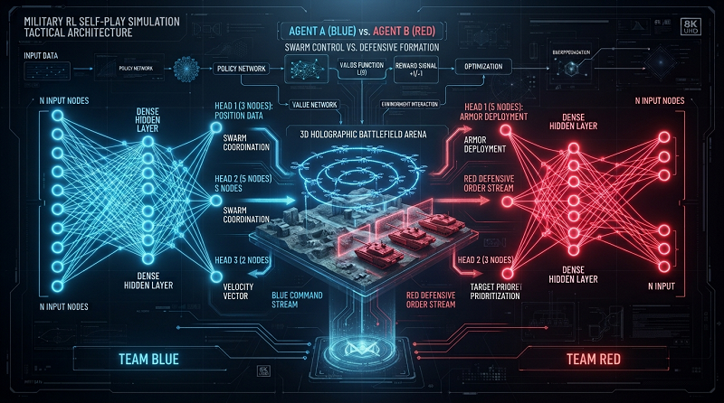

# Tutorial: How to Use AlphaGo Zero Asymmeetric Multi-heads with Metis-Core  (METIS-Core v0.4.0  alpha)

##  Introduction to AlphaGo Zero Asymmeetric Multi-heads

**AlphaGo Zero Asymmetric Multi-Head** is a **self-play** reinforcement learning algorithm where **two opposing teams** (Blue and Red) compete against each other. Each team can consist of one or more AI agents with heterogeneous capabilities.

While pure AlphaGo Zero relies entirely on self-play without domain knowledge, the Metis-Core framework allows for guided learning phases by incorporating a heuristic function. This is implemented via the float getMaterialHeuristicValue(int playerToEvaluateID) method, which provides tactical direction to each team during early training.



## Core Principles of the Learning Process

* **Multi-Agent, Asymmetric Self-Play:** Instead of a single agent playing itself, two distinct teams (Team Blue and Team Red) compete in a shared environment. Each team is controlled by its own dedicated **Multi-Head Deep Neural Network**. Because the teams are asymmetric (e.g., two attacking drones vs. one defending shuttle), Team Blue's network and Team Red's network have completely different output architectures tailored to their specific agents' capabilities.

* **MCTS-Guided Move Selection (Multi-Head):** Moves are selected using **Monte Carlo Tree Search (MCTS)**. During the search, each team's respective neural network evaluates the game state. The network's *Shared Backbone* processes the global environment, while its specific *Policy Heads* output the probability distributions for each individual agent on that team (e.g., Dron 0 and Dron 1). Simultaneously, the single *Value Head* predicts the overall win probability for the entire team, guiding the MCTS on which cooperative branches to explore.

* **Episode End & Dual Experience Buffers: At the end of an episode, the battle's outcome is determined (+1 for a team victory, -1 for a team defeat). This final global reward is assigned to all joint actions executed by the respective team during the episode. Because each team learns independently, the generated training data—comprising the game states, the multi-agent joint search probabilities from MCTS, and the final outcomes—is stored in two separate experience replay buffers (one dedicated to Team Blue and another for Team Red). Each team's buffer is then used exclusively to train its own specific multi-head neural network

* **Closed Feedback Loop:** A continuous, self-improving feedback loop is established for both sides:
  * The multi-head neural networks guide the MCTS to search the joint-action space more efficiently, discovering cooperative tactics (like a pincer movement).
  * The MCTS search generates higher-quality, coordinated training data, which in turn improves the neural networks' policy and value predictions over time.

# Tutorial: Implementing AlphaGo Zero Asymmeetric Multi-heads in Metis-Core


# Metis-Core Example: Kamikaze Drone Swarm

To demonstrate how to build and train an AlphaGo Zero algorithm using Metis-Core, I have implemented the "Kamikaze Drone Swarm" example.


In this example, there are two teams: **Blue** and **Red**.

### Blue Team
* **Composition:** Two Kamikaze drones.
* **Target:** One of the drones must hit the shuttle.
* **Actions:** `STOP`, `LEFT`, `RIGHT`

### Red Team
* **Composition:** A cargo shuttle with beskar armor.
* **Target:** Arrive at the Death Star and protect itself from the drones using a rotating laser cannon. Actually, only the laser cannon is the AI agent; the shuttle has a fixed movement.
* **Actions:** `NONE`, `ROTATE_LEFT_LASER`, `ROTATE_RIGHT_LASER`, `FIRE`


Why "Kamikaze Drone Swarm"? There are two teams, and each team must learn how to defeat the other. It is a **zero-sum environment** (like AlphaGo Zero). Therefore, all AI agents inside a team must learn to collaborate in order to defeat the opposing team.

### Demo: Kamikaze Drone Swarm
Check out the Kamikaze Drone Swarm learning and in action! 🚀

[](https://www.youtube.com/watch?v=kfqHgOiUnMo)

> **Note:** Best experienced with audio! The video features a custom soundtrack composed for the Metis-Core project.

- **Video Link:** [https://www.youtube.com/watch?v=kfqHgOiUnMo) 

# Main Classes in Metis-Core

Metis-Core is completely environment-agnostic. You can easily integrate your own simulation by inheriting from our base classes and overriding the required methods to define your environment's state.
The main class to implemented the "AlphaGo Zero Asymmeetric Multi-heads" are:

Clases derived from Metis-Core clases.

```cpp
class SpaceEnviroment : public Metis::IAlphaGoZeroState<TSPACEENVIROMENT, TACTION_AIRCRAFT>

class Spacecraft : public Metis::IAgent
```

Snippet to call the tranning

```cpp
_IsPresent_GPU = Metis::isCUDAavailable();
//cargar los archivos ia
_pTeamBlue->loadIAModel((char*)"blueTeam.ia", _IsPresent_GPU);
_pTeamRed->loadIAModel((char*)"redTeam.ia", _IsPresent_GPU);

//build the trainer
Metis::AlphaGoZeroAsymTrainer A0GAsymTrainer;

//A0GAsymTrainer.setMaterialHeuristicWeight(0.3);  //set heuristic helper to accelerate the training
A0GAsymTrainer.setCallbackPerStep(this,onStepTraining);
A0GAsymTrainer.setCallbackEndEpisode(this,onEndEpisode);
A0GAsymTrainer.training(_pSpaceEnviroment, _pTeamBlue, _pTeamRed, _IsPresent_GPU);
```

Internaly the objet A0GAsymTrainer, in its learning loop and self-play , will call to this derivated methods from Metis::IAlphaGoZeroState

```cpp
// derived from Metis
// ===============================================================================
// STATE & ENVIRONMENT LIFECYCLE
// ===============================================================================

// Generic: Resets the environment back to its initial starting configuration to begin a fresh episode.
// Kamikaze Drone Swarm: Reinitializes positions/velocities of drones and the shuttle, resets laser heat/cooldown, and clears active bullets.
void reset(int typeReset);

// Generic: Advances the internal continuous time and physics dynamics of the environment by incTime seconds.
// Kamikaze Drone Swarm: Integrates drone/shuttle movement, steps laser bullets forward in 2D space, cools down the laser, and updates collisions.
void update(float incTime = 0.01);

// Generic: Serializes the entire environment state into a flat vector of floating-point values for training.
// Kamikaze Drone Swarm: Packs global positions, velocities, laser angle, temperature, and bullet locations into a flat tensor for AlphaGoZeroTrainer.
std::vector<float> getState();

// Generic: Retrieves the flattened state feature vector from the observation perspective of a specific player or agent.
// Kamikaze Drone Swarm: Generates a feature tensor relative to the requested agent (e.g., relative vector to Shuttle for Drone 0/1, or laser angle for Shuttle).
virtual std::vector<float> getState(int currentPlayer);

// Generic: Creates an exact deep copy of the current state, enabling MCTS to simulate future branches without mutating the real environment.
// Kamikaze Drone Swarm: Duplicates drone/shuttle positions, velocities, active bullet deque, and laser heat states for rollouts.
IAlphaGoZeroStateBase* clone();

// Generic: Indicates whether feature tensors are transformed relative to the active player's frame of reference.
// Kamikaze Drone Swarm: Returns true so feature vectors are normalized relative to the active agent's position/heading instead of absolute world coordinates.
bool isStateRelativeToPlayer() { return true; };

// ===============================================================================
// ACTION SPACE & EXECUTION
// ===============================================================================

// Generic: Executes a discrete action index, mutating internal state to transition to the next step.
// Kamikaze Drone Swarm: Applies discrete physical commands: steers/stops a drone (STOP, LEFT, RIGHT) or operates the laser (NONE, ROTATE_LEFT, ROTATE_RIGHT, FIRE).
void applyAction(int action);

// Generic: Populates a collection with all legally permissible actions available for a specific player in the current state.
// Kamikaze Drone Swarm: Fills the vector with valid aircraft/laser maneuvers (3 movement actions for drones, 4 control actions for the laser cannon).
// TACTION_AIRCRAFT should represent all kind of actions of all agents, even from the team blue and red.
void getPossibleActions(int playerID, std::vector<TACTION_AIRCRAFT>& actions);

// Generic: Returns the discrete action space size available for a given player or agent type.
// Kamikaze Drone Swarm: Returns 3 for Drone agents (STOP, LEFT, RIGHT) or 4 for the Shuttle's Laser Cannon agent (NONE, ROTATE_LEFT, ROTATE_RIGHT, FIRE).
virtual int getNumActions(int currentPlayer);

// Generic: Verifies whether a specific action index is legally permissible under current state rules.
// Kamikaze Drone Swarm: Validates action bounds and checks if laser fire is allowed (e.g., blocking FIRE if overheated or in cooldown).


// ===============================================================================
// REWARD, TERMINAL STATE & HEURISTICS
// ===============================================================================

// Generic: Checks whether the current state represents an end-of-episode or terminal condition.
// Kamikaze Drone Swarm: Returns true if a drone hits the shuttle (Blue win), all drones are destroyed (Red win), or max time steps elapse.
bool isTerminal();

// Generic: Identifies which player or team won the game once a terminal state is reached.
// Kamikaze Drone Swarm: Returns TEAM_BLUE_ID if at least one drone strikes the shuttle, TEAM_RED_ID if all drones are destroyed, or draw ID on timeout.
int getWinner();

// Generic: Retrieves the zero-sum numerical reward outcome (+1.0, -1.0, 0.0) for a specific team at episode conclusion.
// Kamikaze Drone Swarm: Returns +1.0 for victory, -1.0 for defeat, and 0.0 for a draw from teamID's perspective.
double getReward(int teamID);

// Generic: Provides a domain-specific continuous evaluation score bounded in [-1.0, 1.0] to guide MCTS rollouts during early learning.
// Kamikaze Drone Swarm: Evaluates pincer movement quality (drone separation, arrival synchronization, distance) vs. laser exposure threat to guide flanking.
float getMaterialHeuristicValue(int playerToEvaluateID);


// ===============================================================================
// PLAYER & TEAM MANAGEMENT
// ===============================================================================

// Generic: Returns the identifier of the player or agent whose turn/step it is to act.
// Kamikaze Drone Swarm: Identifies whether the active agent in the current sub-step is Drone 0, Drone 1, or the Shuttle's Laser Cannon.
int getCurrentPlayerID() override { return _currentPlayer; };

// Generic: Maps an individual agent/player identifier to its overarching team ID.
// Kamikaze Drone Swarm: Returns TEAM_BLUE_ID for Drones 0 and 1, or TEAM_RED_ID for the Shuttle's Laser Cannon.
virtual int getTeamID(int currentPlayerID);
```

# METIS-Core — Asymmetric AlphaZero Usage Guide

> How the **"Kamikaze drones vs Imperial Shuttle"** example is built, and how to use it as a template for your own problem with METIS-Core's `AlphaGoZeroAsymTrainer`.

**Target audience:** intermediate C++ programmers. You don't need deep AlphaZero knowledge. It helps to know, at a conceptual level, what a neural network with *policy* and *value* outputs is, and what MCTS (Monte Carlo Tree Search) is.

> ⚠️ **About the signatures:** the headers `AlphaGoZeroAsymTrainer.h`, `IAlphaGoZeroState.h` and `Laser.h` are not part of this guide. The signatures shown here for those classes are **inferred from how the example uses them** (`MyView.cpp`, `SpaceEnviroment.h/.cpp`). If any of them differ, check the actual header.

---

## Table of contents

1. [What asymmetric AlphaZero solves](#1-what-asymmetric-alphazero-solves)
2. [Overall architecture](#2-overall-architecture)
3. [Key concepts: player, team, head and turn](#3-key-concepts-player-team-head-and-turn)
4. [The example scenario](#4-the-example-scenario)
5. [Step 1 — The agents (`IAgent`)](#5-step-1--the-agents-iagent)
6. [Step 2 — The environment (`IAlphaGoZeroState`)](#6-step-2--the-environment-ialphagozerostate)
7. [Step 3 — Per-player observations](#7-step-3--per-player-observations)
8. [Step 4 — Building the teams (`MultiHeadBrainBuilder`)](#8-step-4--building-the-teams-multiheadbrainbuilder)
9. [Step 5 — Training (`AlphaGoZeroAsymTrainer`)](#9-step-5--training-alphagozeroasymtrainer)
10. [Step 6 — Playing / inference](#10-step-6--playing--inference)
11. [Optional — Material heuristic](#11-optional--material-heuristic)
12. [Optional — Curriculum learning in `reset`](#12-optional--curriculum-learning-in-reset)
13. [Minimal template for your own problem](#13-minimal-template-for-your-own-problem)
14. [Checklist and common mistakes](#14-checklist-and-common-mistakes)
15. [Quick API reference](#15-quick-api-reference)

---

## 1. What asymmetric AlphaZero solves

Classic AlphaZero (Go, chess) assumes a **symmetric** game. Both players have the same rules, the same action space and the same neural network.

METIS-Core's **asymmetric** AlphaZero is designed for games where:

- There are **two teams** with opposite goals (zero-sum: whatever one team gains, the other loses).
- Each team can have a **different number of players**.
- Each team has **its own observations** (different number of inputs) and **its own actions** (different number of outputs).
- Each team has **its own multi-head neural network**: one *policy* head per player in the team, plus one *value* head shared by the team.

Training is done through *self-play*. The two teams play against each other, network-guided MCTS produces the best moves, and those games become training data for both networks.

---

## 2. Overall architecture

```
                    ┌────────────────────────────────────────────┐
                    │          AlphaGoZeroAsymTrainer            │
                    │  (self-play + MCTS + network training)     │
                    └──────────────┬──────────────┬──────────────┘
                                   │              │
             ┌─────────────────────┘              └───────────────────────┐
             ▼                                                            ▼
┌──────────────────────────┐   ┌──────────────────────────┐   ┌──────────────────────────┐
│  MultiHeadAgent (Blue)   │   │  Your environment        │   │  MultiHeadAgent (Red)    │
│  ─ head "xwinDrone_1"    │   │  SpaceEnviroment :       │   │  ─ head "ImperialShuttle"│
│  ─ head "xwinDrone_2"    │   │  IAlphaGoZeroState<      │   │  ─ head "valueHead"      │
│  ─ head "valueHead"      │   │    TSPACEENVIROMENT,     │   │  inputs = 18             │
│  inputs = 14             │   │    TACTION_AIRCRAFT>     │   │  actions/head = 4        │
│  actions/head = 4        │   │                          │   │                          │
└──────────────────────────┘   │  holds the IAgents:      │   └──────────────────────────┘
                               │   Spacecraft x3          │
                               └──────────────────────────┘
```

You have to write **three things**:

| Piece | METIS-Core base class | In the example |
|---|---|---|
| The agents (game entities) | `Metis::IAgent` | `Spacecraft` |
| The game environment / state | `Metis::IAlphaGoZeroState<TState, TAction>` | `SpaceEnviroment` |
| The application that builds the teams, trains and plays | — | `MyView` (wxWidgets) |

---

## 3. Key concepts: player, team, head and turn

### Player
Each entity that makes decisions. Players are identified by a **sequential ID starting at 0** (`0..N-1`). In the example:

| ID | Entity | Team |
|---|---|---|
| 0 | Kamikaze drone 1 | Blue (0) |
| 1 | Kamikaze drone 2 | Blue (0) |
| 2 | Imperial Shuttle | Red (1) |

> The code comment states this explicitly: *"ID of the player must be sequencial (from 0 o N)"*. The framework uses this ID for indexing.

### Team
A group of players that share a goal and a neural network. The environment maps player → team through `getTeamID(playerID)`.

### Head
In a team's multi-head network, each player has **its own policy head**, which outputs a probability vector over that player's actions. All heads share the *backbone* (common layers). There is also one **value head** per team, which estimates "how well is my team doing?" in `[-1, 1]`.

### Turn
Even though the simulation is continuous, AlphaZero treats it as a **turn-based** game. The environment keeps a `_currentPlayer`. That player's action is applied, and the turn then passes to the next **active** player (destroyed players are skipped). MCTS explores the tree of turns.

---

## 4. The example scenario

- **Blue team:** 2 kamikaze drones. They win if either of them gets within 25 px of the shuttle.
- **Red team:** 1 shuttle moving at constant speed towards the Death Star (the *target*). It has a **rotating laser turret** and a sensor with a 200 px range. It wins if it reaches the target (< 10 px), or if both drones are out of action (destroyed, or collided with the map boundaries).
- **Draw:** if more than `MAX_STEPS` (2000) steps elapse.

Actions:

```cpp
enum class TEAM_BLUE_ACTIONS { STOP = 0, TURN_LEFT, AHEAD, TURN_RIGHT, MAX_ACTIONS };          // 4
enum class TEAM_RED_ACTIONS  { NONE = 0, ROTATE_LEFT_TURRET, ROTATE_RIGHT_TURRET, FIRE_LASER, MAX_ACTIONS }; // 4
```

Putting `MAX_ACTIONS` as the last enum value is a handy pattern: it gives you the number of outputs of each head directly.

---

## 5. Step 1 — The agents (`IAgent`)

Each game entity derives from `Metis::IAgent`. `Spacecraft` represents both the drones and the shuttle, which are told apart by `ShipType`.

```cpp
class Spacecraft : public Metis::IAgent
{
public:
    // ... domain-specific physics, sensors, weapons ...

    void applyAction(int action);         // maps the action index to behaviour

    // Functions to override from the framework
    virtual int  update(double delta_time);              // advances physics by one delta
    virtual int  getActionProcedural(Metis::State& s);   // hand-coded bot (optional)
    virtual bool isValidAction(int iAction);              // action mask (optional)
    virtual void endStep();                               // cleanup at the end of each step
};
```

### What each virtual method does

| Method | Required | Use in the example |
|---|---|---|
| `update(dt)` | Yes, in practice | Integrates position from `heading` and `speed`. For the shuttle, it also updates the sensor and the laser. If the agent is not in the `searched` (active) state, it does nothing. |
| `getActionProcedural(state)` | No | Returns 0. Useful if you want a hand-coded opponent. |
| `isValidAction(a)` | No | Always `true`. If your problem has illegal actions in some states, filter them here. |
| `endStep()` | No | Resets `_Laser_tried_fired`. |
| `setID(int)` / `getID()` | Inherited | Called at construction with IDs 0, 1, 2. |

### `applyAction`: from index to physics

```cpp
void Spacecraft::applyAction(int action)
{
    if (getState() == destroyed) return;   // a dead agent does not act

    if (_typeShip == ShipType::XWingDrone)
    {
        switch ((TEAM_BLUE_ACTIONS)action)
        {
        case TEAM_BLUE_ACTIONS::STOP:       Stop();      break;
        case TEAM_BLUE_ACTIONS::TURN_LEFT:  TurnLeft();  break;   // heading -15º
        case TEAM_BLUE_ACTIONS::AHEAD:                   break;   // keep heading
        case TEAM_BLUE_ACTIONS::TURN_RIGHT: TurnRight(); break;   // heading +15º
        }
    }
    if (_typeShip == ShipType::Shuttle)
    {
        switch ((TEAM_RED_ACTIONS)action)
        {
        case TEAM_RED_ACTIONS::ROTATE_LEFT_TURRET:  Rotate_TurrentLeft();  break;
        case TEAM_RED_ACTIONS::ROTATE_RIGHT_TURRET: Rotate_TurrentRight(); break;
        case TEAM_RED_ACTIONS::FIRE_LASER:          FireLaser();           break;
        default: break;
        }
    }
}
```

**Key lesson:** actions are **discrete** and applied as *increments* (turn 15º, rotate turret), not as absolute values. This keeps the action space small, which is critical for MCTS efficiency.

### Coordinate convention
`heading` is in degrees, with `0º = +Y` and `90º = +X`:

```cpp
vx = speed * sin(headingRad);
vy = speed * cos(headingRad);
```

### Copying agents (important for MCTS)
MCTS clones the environment thousands of times. `Spacecraft` implements a copy constructor, `operator=` and `operator!=`. Note that **internal pointers are re-pointed to the new owner**:

```cpp
Spacecraft& Spacecraft::operator=(Spacecraft& other)
{
    // ... field copies ...
    _sensor = other._sensor;
    _sensor.Set(this);       // the sensor now belongs to THIS ship, not the original!
    _laser  = other._laser;
    // ...
}
```

If your agents hold pointers (to their environment, to subsystems, to other agents), **you must reassign them after copying**. Otherwise the clone will modify the original's state.

---

## 6. Step 2 — The environment (`IAlphaGoZeroState`)

This is the central piece. It derives from the template:

```cpp
class SpaceEnviroment
    : public Metis::IAlphaGoZeroState<TSPACEENVIROMENT, TACTION_AIRCRAFT>
```

- `TSPACEENVIROMENT`: struct holding the "joint" game state. The example barely uses it; the real state lives in the class members.
- `TACTION_AIRCRAFT`: action struct. It must provide `int toIndex(int currentPlayer) const`.

```cpp
typedef struct _stAction
{
    int typeAction;
    int toIndex(int currentPlayer) const { return typeAction; }
} TACTION_AIRCRAFT;
```

### Agents live inside the environment

```cpp
// SpaceEnviroment.h
Spacecraft _drone_XWing_1;
Spacecraft _drone_XWing_2;
Spacecraft _ImperialShuttle;

// Constructor
SpaceEnviroment::SpaceEnviroment()
{
    _drone_XWing_1.setID(0);
    _drone_XWing_2.setID(1);
    _ImperialShuttle.setID(2);

    this->addAgent(&_drone_XWing_1);   // registers it in the framework's internal map
    this->addAgent(&_drone_XWing_2);
    this->addAgent(&_ImperialShuttle);
}
```

They are later retrieved with the inherited `getAgentByID(id)` and `getNumAgents()`.

### Methods you must implement

Grouped as in the header:

#### Lifecycle

| Method | What it must do | Example |
|---|---|---|
| `void reset(int type)` | Put the environment at the start of an episode. | Places the shuttle and drones, resets the step counter, applies curriculum (see §12). |
| `void update(float dt)` | Advance the physics of **all** agents by one step. | Calls `update(DELTA_TIME)` on each ship, marks `collision` if a ship leaves the map, increments `_currenteStep`. |
| `double getDeltaTime()` | Simulation time step. | `0.2` (`DELTA_TIME`). A larger value speeds up training at the cost of precision. |
| `IAlphaGoZeroStateBase* clone()` | **Deep** copy of the state for MCTS. | `new SpaceEnviroment(*this)`. |
| `bool isEqualState(IAlphaGoZeroStateBase*)` | Compares two states (used by the framework to detect repeated states). | Compares the target, the counters and the three ships with `operator!=`. |
| `std::vector<float> getState()` | Player-independent version. | Returns a dummy vector `{1,1,1}`; the asymmetric trainer uses the per-player version. |
| `std::vector<float> getState(int player)` | **Observation for player `player`**, normalized. | See §7. |
| `bool isStateRelativeToPlayer()` | `true` if the observation depends on who is looking. | `true`. |

#### Actions

| Method | What it must do |
|---|---|
| `void applyAction(int action)` | Apply the action to `_currentPlayer` **and pass the turn** to the next active player. |
| `void getPossibleActions(int player, std::vector<TAction>& out)` | Fill in the player's legal actions. In the example, all of them (`0..MAX_ACTIONS-1`) according to the player's team. |
| `int getNumActions(int player)` | Number of outputs of that player's head. |
| `bool is_valid_action(int a)` | Extra validation (always `true` here). |

#### Reward and terminal state

| Method | What it must do |
|---|---|
| `bool isTerminal()` | Detect the end of the game **and set the winner** (`_teamWinner`). |
| `int getWinner()` | `TEAM_BLUE_ID`, `TEAM_RED_ID` or `-1` (draw). |
| `double getReward(int teamID)` | `+1` if `teamID` won, `-1` if it lost, `0` for a draw or a game in progress. |
| `float getMaterialHeuristicValue(int player)` | Optional: intermediate evaluation in `[-1, 1]` (§11). |

#### Players and teams

| Method | What it must do |
|---|---|
| `int getCurrentPlayerID()` | Return `_currentPlayer`. |
| `int getTeamID(int player)` | Map player → team. |

### Turn management in detail

```cpp
bool SpaceEnviroment::isPlayerActive(int playerID)
{
    Spacecraft* p = (Spacecraft*)getAgentByID(playerID);
    if (p == NULL) return false;
    int s = p->getState();
    return (s != destroyed) && (s != collision);
}

void SpaceEnviroment::advanceToNextActivePlayer(bool bIncludeCurrent)
{
    int start = bIncludeCurrent ? 0 : 1;
    for (int i = start; i <= MAX_PLAYERS; i++)
    {
        int candidate = (_currentPlayer + i) % MAX_PLAYERS;   // circular rotation 0→1→2→0
        if (isPlayerActive(candidate)) { _currentPlayer = candidate; return; }
    }
    // nobody active: isTerminal() will close the episode
}

void SpaceEnviroment::applyAction(int action)
{
    Spacecraft* p = (Spacecraft*)getAgentByID(_currentPlayer);
    if (isPlayerActive(_currentPlayer))
        p->applyAction(action);

    advanceToNextActivePlayer(false);   // the turn is always passed on
}
```

**Why it matters:** if a drone dies, the MCTS tree must stop generating nodes for it. Skipping it in the rotation avoids "empty" turns that waste simulations.

> 💡 `applyAction` does **not** call `update()`. The action only changes heading or turret angle; physics advances when the environment's `update(dt)` is called. In play mode (`OnTimer`) this is clear: the 3 actions are applied, then a single `update` runs. Make sure your environment follows the same contract.

### `isTerminal()` — order of checks

The order matters because several conditions can be true at the same time:

1. **Time limit** → draw.
2. **Drone within 25 px of the shuttle** → Blue wins (and the shuttle is marked `destroyed`).
3. **Shuttle within 10 px of the target** → Red wins.
4. **Both drones out of action** → Red wins.
5. Otherwise → the game continues.

`isTerminal()` is the method that **writes** `_teamWinner`; `getReward()` and `getWinner()` only read it.

### `clone()` and the copy constructor

```cpp
SpaceEnviroment::SpaceEnviroment(SpaceEnviroment& other)
{
    // copy scalar state
    _posTarget     = other._posTarget;
    _currentPlayer = other._currentPlayer;
    _currenteStep  = other._currenteStep;
    // ...

    // copy agents
    _drone_XWing_1   = other._drone_XWing_1;
    _drone_XWing_2   = other._drone_XWing_2;
    _ImperialShuttle = other._ImperialShuttle;

    // RE-POINT pointers to the new environment
    _drone_XWing_1._pEnv   = this;
    _drone_XWing_2._pEnv   = this;
    _ImperialShuttle._pEnv = this;
    _ImperialShuttle._laser.setPlatform(&_ImperialShuttle);
    _drone_XWing_1._laser.setPlatform(&_drone_XWing_1);
    _drone_XWing_2._laser.setPlatform(&_drone_XWing_2);

    // register the CLONE's agents (not the original's)
    this->addAgent(&_drone_XWing_1);
    this->addAgent(&_drone_XWing_2);
    this->addAgent(&_ImperialShuttle);
}
```

This is probably **the most delicate part** of the whole implementation. A clone that shares pointers with the original silently corrupts the search tree.

---

## 7. Step 3 — Per-player observations

`getState(int currentPlayer)` returns what that player "sees". It is the input to **its team's** network, so its size depends on the team:

```cpp
#define TEAM_BLUE_INPUTS 14
#define TEAM_RED_INPUTS  18
```

### Recommended pattern: structs with `toVector`

The example defines flat structs that serialize to `std::vector<float>`:

```cpp
typedef struct _dronePhysicalData        // 6 floats
{
    float heading, x, y, vx, vy, isAlive;
    void toVector(std::vector<float>& in)
    { in.push_back(heading); in.push_back(x); in.push_back(y);
      in.push_back(vx); in.push_back(vy); in.push_back(isAlive); }
} TDRONE_PHYSICAL_DATA;

typedef struct _obsDroneXWING            // 2 + 6 + 6 = 14 floats
{
    float shuttle_turret_heading;
    float shuttle_laser_cooldown;
    TDRONE_PHYSICAL_DATA me;
    TDRONE_PHYSICAL_DATA wingman;
    // toVector(...)
} TOBS_DRON_XWING;

typedef struct _obsShuttle               // 3 + 2*6 + 3 = 18 floats
{
    float heading, shuttle_turret_heading, numberOf_DroneX_WingDetected;
    TDRONE_PHYSICAL_DATA droneDetected[MAX_DRONES_XWING];
    float shuttle_laser_cooldown, Laser_fired, Laser_firing;
    // toVector(...)
} TOBS_SHUTTLE;
```

Advantages: you can verify the number of inputs by counting fields, and the serialization order is defined in a single place.

### Observation design decisions

| Decision | Implementation | Why |
|---|---|---|
| **Relative coordinates** | Drone position/velocity *relative to the shuttle* | The network generalizes better: the tactical situation does not depend on where on the map it happens. |
| **Normalization** | `x / 600`, `heading / 360`, `v / (vDrone + vShuttle)` | Inputs in similar ranges (~`[-1, 1]`) stabilize training. |
| **Wingman awareness** | Each drone sees its *wingman* | Enables coordinating the pincer manoeuvre. |
| **Partial observability** | The shuttle only sees drones inside its sensor range; empty slots are zero-filled | Models imperfect information. |
| **Sorted by threat** | `getDronesDetected()` is sorted, closest first | The network does not have to learn sorting. |
| **0/1 flags** | `isAlive`, `Laser_firing` | Direct boolean information. |

> ⚠️ `TEAM_BLUE_INPUTS` / `TEAM_RED_INPUTS` must match **exactly** the size of the vector returned by `getState(player)` for each team. A mismatch usually triggers a dimension error in LibTorch, or worse, out-of-range reads.

---

## 8. Step 4 — Building the teams (`MultiHeadBrainBuilder`)

Each team is a `Metis::MultiHeadAgent` built with the fluent *builder*:

```cpp
Metis::MultiHeadBrainBuilder multiBuilderTeamBlue;
Metis::MultiHeadBrainBuilder multiBuilderTeamRed;
bool bGPU = Metis::isCUDAavailable();

// Blue team: 2 policy heads + 1 value head
_pTeamBlue = multiBuilderTeamBlue
    .addHead(std::string(NAME_XWINDRONE_1), _drone_XWing_1)   // head ↔ agent
    .addHead(std::string(NAME_XWINDRONE_2), _drone_XWing_2)
    .addValueHead(std::string("valueHead"))
    .setNumberInputsOutputs(TEAM_BLUE_INPUTS, (int)TEAM_BLUE_ACTIONS::MAX_ACTIONS)
    .useGPU(bGPU)
    .build();
_pTeamBlue->setID(TEAM_BLUE_ID);   // a MultiHeadAgent's ID is the TEAM ID

// Red team: 1 policy head + 1 value head
_pTeamRed = multiBuilderTeamRed
    .addHead(std::string(NAME_SHUTTLE), _ImperialShuttle)
    .addValueHead(std::string("valueHead"))
    .setNumberInputsOutputs(TEAM_RED_INPUTS, (int)TEAM_RED_ACTIONS::MAX_ACTIONS)
    .useGPU(bGPU)
    .build();
_pTeamRed->setID(TEAM_RED_ID);
```

| Call | Meaning |
|---|---|
| `addHead(name, IAgent*)` | One policy head per player in the team. The name is used later in the metrics. |
| `addValueHead(name)` | The team's value head. **Required for AlphaZero.** |
| `setNumberInputsOutputs(in, outPerHead)` | Observation size and number of actions of **each** head (all heads in a team share the same number of actions). |
| `useGPU(bool)` | Train/infer on CUDA if available. |
| `build()` | Returns the ready-to-use `MultiHeadAgent*`. |

### Saving and loading models

```cpp
_pTeamBlue->loadIAModel((char*)"blueTeam.ia", bGPU);   // resumes a previous training run if present
_pTeamRed ->loadIAModel((char*)"redTeam.ia",  bGPU);
// ...
_pTeamBlue->saveIAModel((char*)"blueTeam.ia");
```

The example loads them before training so that interrupted training runs can be resumed.

---

## 9. Step 5 — Training (`AlphaGoZeroAsymTrainer`)

```cpp
void MyView::StartTraningMultiheads()
{
    bool bGPU = Metis::isCUDAavailable();
    _pTeamBlue->loadIAModel((char*)"blueTeam.ia", bGPU);
    _pTeamRed ->loadIAModel((char*)"redTeam.ia",  bGPU);

    Metis::AlphaGoZeroAsymTrainer trainer;

    // trainer.setMaterialHeuristicWeight(0.3);   // optional, see §11
    trainer.setCallbackPerStep(this, onStepTraining);
    trainer.setCallbackEndEpisode(this, onEndEpisode);

    // blocking self-play + training loop
    trainer.training(_pSpaceEnviroment, _pTeamBlue, _pTeamRed, bGPU);
}
```

`training()` is **blocking**: it runs episodes indefinitely (or until the framework decides to stop). All interaction with the application goes through the callbacks.

### Callbacks

Signature (inferred from usage):

```cpp
void onStepTraining(void* pSender, Metis::TSEARCHACTIONASYM* pMetrics);
void onEndEpisode  (void* pSender, Metis::TSEARCHACTIONASYM* pMetrics);
```

`pSender` is the pointer you passed to `setCallbackXXX(this, ...)`. The example also uses a `MyView::_pSelf` singleton because the callbacks are free functions.

`TSEARCHACTIONASYM` fields used by the example:

| Field | Content |
|---|---|
| `episode`, `step` | Current episode and step. |
| `pState` | Pointer to the environment (cast it to your class). |
| `playerID` | Player that just made a decision. |
| `actionValue` | Expected value of the chosen action according to MCTS. |
| `maxDepthActionNode` | Maximum depth reached in the tree. |
| `metricsTeamBlue`, `metricsTeamRed` | Each team's `TASYMMULTIHEADAGENTMETRICS`. |

Inside `TASYMMULTIHEADAGENTMETRICS`:

| Field | Content |
|---|---|
| `_meanValueHeadLoss` | Mean loss of the team's value head. |
| `_headMetric` | `std::map<std::string, ASYMTHEADMETRIC>` keyed by head name. |
| `_headMetric[n]._meanPolicyHeadLoss` | Mean policy loss of that head. |

### What the example does in each callback

**`onStepTraining`**:
- Stores `actionValue` in the vector of the corresponding team (via `getTeamID(playerID)`).
- In Debug builds it draws every step; in Release only if display has been enabled.
- Every 10 steps it calls `wxTheApp->Yield()` so the GUI does not freeze while `training()` blocks the thread.

**`onEndEpisode`**:
- Adds the win to the winner's counter (`getWinner()`).
- Computes Blue / Red / draw percentages.
- Keeps moving averages of the losses (window `METRICS_X_EPISODES = 50`) and a win-rate history (400 episodes) for the *sparklines*.
- Writes everything to `traningKamikazeDrones.txt`.

### How to read the metrics

| Signal | Rough interpretation |
|---|---|
| Policy loss going down | The network is learning to imitate MCTS decisions. |
| Value loss going down | The network predicts the winner more accurately. |
| One team's win rate → 100 % | Imbalance: the other team can't find a counter-strategy, or the scenario is too easy for one side. Review reset/curriculum. |
| Draws → 100 % | Neither side knows how to finish the game; review `MAX_STEPS`, rewards or the material heuristic. |
| Mean `actionValue` of both teams ≈ 0 and stable | Approximate balance in self-play. |

---

## 10. Step 6 — Playing / inference

To use the trained models, you create a "player" agent that wraps MCTS plus the two networks:

```cpp
void MyView::Play(int modeBot)
{
    _pTeamBlue->loadIAModel((char*)"blueTeam.ia", false);
    _pTeamRed ->loadIAModel((char*)"redTeam.ia",  false);
    _pSpaceEnviroment->reset(0);

    // the networks are injected with setTeamBlueRed, so the file names are empty
    _teamBluePlayAgent = Metis::createAsymAlphaZeroGoAgentFromModelFile(
        _pSpaceEnviroment, (char*)"", 0, 0, (char*)"", 0, 0, false);
    _teamBluePlayAgent->setTeamBlueRed(_pTeamBlue, _pTeamRed);
    _teamBluePlayAgent->setSearchIterations(300);   // MCTS simulations per decision

    m_pPlayTimer->Start(TIME_EACH_TICK);             // one tick every 33 ms
}
```

And on every tick:

```cpp
void MyView::OnTimer(wxTimerEvent& event)
{
    _pSpaceEnviroment->_currentPlayer = 0;

    // the AI decides for both drones
    int dron1Action = _teamBluePlayAgent->selectActionAsym(_pSpaceEnviroment, 0);
    int dron2Action = _teamBluePlayAgent->selectActionAsym(_pSpaceEnviroment, 1);

    // the human controls the shuttle with the keyboard
    int shuttleAction = ReadFromKeyboard();

    // apply in turn order: 0 → 1 → 2 (applyAction advances _currentPlayer)
    _pSpaceEnviroment->_currentPlayer = 0;
    _pSpaceEnviroment->applyAction(dron1Action);
    _pSpaceEnviroment->applyAction(dron2Action);
    _pSpaceEnviroment->applyAction(shuttleAction);

    // a single physics integration after the full round
    _pSpaceEnviroment->update(_pSpaceEnviroment->getDeltaTime());

    // check for end of game...
}
```

| Function | Use |
|---|---|
| `createAsymAlphaZeroGoAgentFromModelFile(env, fBlue, inBlue, actBlue, fRed, inRed, actRed, gpu)` | Creates the player agent. It can load models from file or, as here, receive them later. |
| `setTeamBlueRed(blue, red)` | Injects the already-loaded `MultiHeadAgent`s. |
| `setSearchIterations(n)` | Quality vs. time per decision. 300 is reasonable for real time. |
| `selectActionAsym(env, playerID)` | Runs MCTS from the current state and returns the best action for `playerID`. |
| `deleteAgent(pAgent)` | Frees the agent created by the DLL (use this, not `delete`). |

> For "AI vs AI", just also call `selectActionAsym(env, 2)` for the shuttle instead of reading the keyboard.

---

## 11. Optional — Material heuristic

In long games (up to 2000 steps), the `±1` reward only arrives at the end, and MCTS can take a long time to find any signal. `getMaterialHeuristicValue(player)` provides an **intermediate evaluation** that the trainer can blend with the value head:

```cpp
trainer.setMaterialHeuristicWeight(0.3);   // during training
agent->setMaterialHeuristicWeight(0.3);    // during inference (IAgent)
```

Requirements for the returned value:

- Range `[-1, 1]`.
- **Zero-sum**: if it is `v` for Blue, it must be `-v` for Red.
- From the point of view of `player`'s **team**.

The example combines:

```text
blueAdvantage = 0.3 * material + 0.7 * (blueQuality - redQuality)

material     = -(destroyed drones) / 2                     → 0, -0.5, -1
blueQuality  = 0.4 * pincer + 0.6 * weightedApproach
               pincer    = angular separation of the drones (± distance synchrony)
               approach  = closeness + velocity towards the shuttle (penalized if bunched together)
redQuality   = 0.8 * threat + 0.2 * aim
               threat    = most exposed drone inside the turret cone (cos^8), reduced if there is a pincer
               aim       = how close the laser shot passes to its target

return (team == BLUE) ? blueAdvantage : -blueAdvantage;
```

Tips for designing your own:

- Normalize each term to `[0, 1]` before weighting.
- Use `dirSegura()` (a safe-normalize helper) or similar to avoid `NaN` with near-zero vectors.
- Start with a low weight (0.1–0.3). If it is too high, the AI learns to optimize the heuristic instead of winning.
- In the example it is **disabled** (commented out); you enable it when training does not take off.

---

## 12. Optional — Curriculum learning in `reset`

`reset()` delegates to `reset3()`, which holds the curriculum logic:

- **Phases of 100 episodes** (up to 10): `difficultyFactor` goes from 0 to 1.
- **Shuttle turret** rotates 45º every 25 episodes, so the drones can't memorize a single attack angle.
- **Drone spawn radius**: between 205 and 240 px (just outside the 200 px sensor), with the maximum growing with difficulty.
- **Pincer angle** between drones: from 180º (easy, attack from opposite sides) to 15º (hard, bunched together), plus random noise.

> In the current version of `reset3()`, the random values are overwritten with fixed values (`r = -215`, `θ = ±10º`). As a result, the drones always start at the same position and only the turret varies. This is probably a debugging setup; check it if you want the full curriculum.

`reset2()` and the rest of `reset()`'s body (unreachable code after the `return`) are earlier curriculum variants.

---

## 13. Minimal template for your own problem

Generic example: a game with 2 teams, `N_A` players in team A and `N_B` in team B.

### 13.1 Definitions

```cpp
// MyGame.h
#pragma once
#include "METIS-Core.h"

#define TEAM_A_ID 0
#define TEAM_B_ID 1
#define MAX_PLAYERS 3        // total players (IDs 0..2)
#define TEAM_A_INPUTS 10     // EXACT size of getState() for team A
#define TEAM_B_INPUTS 8      // EXACT size of getState() for team B
#define MAX_STEPS 500

enum class TEAM_A_ACTIONS { NONE = 0, LEFT, RIGHT, MAX_ACTIONS };
enum class TEAM_B_ACTIONS { NONE = 0, FIRE, MAX_ACTIONS };

struct TMY_STATE { int dummy; };                  // joint state (can be trivial)
struct TMY_ACTION
{
    int id;
    int toIndex(int currentPlayer) const { return id; }
};
```

### 13.2 The agent

```cpp
class MyAgent : public Metis::IAgent
{
public:
    float x = 0, y = 0;
    bool  alive = true;
    class MyEnvironment* _pEnv = nullptr;   // if you use it, re-point it when cloning

    void applyAction(int a)
    {
        if (!alive) return;                 // a dead agent does not act
        // map index -> discrete state change
    }

    virtual int  update(double dt) override { /* integrate physics */ return 0; }
    virtual bool isValidAction(int a) override { return true; }
    virtual void endStep() override {}

    bool operator!=(const MyAgent& o) const
    { return x != o.x || y != o.y || alive != o.alive; }
};
```

### 13.3 The environment

```cpp
class MyEnvironment : public Metis::IAlphaGoZeroState<TMY_STATE, TMY_ACTION>
{
public:
    MyAgent _players[MAX_PLAYERS];
    int _currentPlayer = 0;
    int _step = 0;
    int _winner = -1;

    MyEnvironment()
    {
        for (int i = 0; i < MAX_PLAYERS; i++)
        {
            _players[i].setID(i);              // sequential IDs starting at 0
            _players[i]._pEnv = this;
            addAgent(&_players[i]);
        }
    }

    MyEnvironment(MyEnvironment& o)
    {
        _currentPlayer = o._currentPlayer;
        _step   = o._step;
        _winner = o._winner;
        for (int i = 0; i < MAX_PLAYERS; i++)
        {
            _players[i] = o._players[i];
            _players[i].setID(i);
            _players[i]._pEnv = this;          // re-point to the clone!
            addAgent(&_players[i]);            // register the clone's agents
        }
    }

    // ---- lifecycle ----
    void reset(int type)
    {
        _step = 0; _winner = -1; _currentPlayer = 0;
        // place the players (with randomness to avoid overfitting)
    }
    void update(float dt)
    {
        for (int i = 0; i < MAX_PLAYERS; i++) _players[i].update(dt);
        _step++;
    }
    double getDeltaTime() override { return 0.2; }

    IAlphaGoZeroStateBase* clone() { return new MyEnvironment(*this); }

    bool isEqualState(IAlphaGoZeroStateBase* p) override
    {
        MyEnvironment* o = (MyEnvironment*)p;
        for (int i = 0; i < MAX_PLAYERS; i++)
            if (_players[i] != o->_players[i]) return false;
        return true;
    }

    // ---- observations ----
    std::vector<float> getState() { return { 1.0f }; }
    bool isStateRelativeToPlayer() { return true; }

    std::vector<float> getState(int player) override
    {
        std::vector<float> v;
        if (getTeamID(player) == TEAM_A_ID)
        {
            // fill EXACTLY TEAM_A_INPUTS floats, normalized and relative to 'player'
        }
        else
        {
            // fill EXACTLY TEAM_B_INPUTS floats
        }
        return v;
    }

    // ---- actions and turns ----
    bool isPlayerActive(int id) { return _players[id].alive; }

    void advanceToNextActivePlayer()
    {
        for (int i = 1; i <= MAX_PLAYERS; i++)
        {
            int c = (_currentPlayer + i) % MAX_PLAYERS;
            if (isPlayerActive(c)) { _currentPlayer = c; return; }
        }
    }

    void applyAction(int action)
    {
        if (isPlayerActive(_currentPlayer))
            _players[_currentPlayer].applyAction(action);
        advanceToNextActivePlayer();           // always pass the turn
    }

    int getNumActions(int player) override
    {
        return (getTeamID(player) == TEAM_A_ID) ? (int)TEAM_A_ACTIONS::MAX_ACTIONS
                                                : (int)TEAM_B_ACTIONS::MAX_ACTIONS;
    }

    void getPossibleActions(int player, std::vector<TMY_ACTION>& acts)
    {
        acts.clear();
        for (int a = 0; a < getNumActions(player); a++) acts.push_back({ a });
    }

    bool is_valid_action(int a) { return true; }

    // ---- terminal state and reward ----
    bool isTerminal()
    {
        if (_step > MAX_STEPS) { _winner = -1; return true; }   // draw
        // if (team A wins) { _winner = TEAM_A_ID; return true; }
        // if (team B wins) { _winner = TEAM_B_ID; return true; }
        return false;
    }
    int getWinner() { return _winner; }

    double getReward(int teamID)
    {
        if (_winner == -1) return 0.0;
        return (teamID == _winner) ? 1.0 : -1.0;
    }

    float getMaterialHeuristicValue(int player) { return 0.0f; }   // optional

    // ---- players/teams ----
    int getCurrentPlayerID() override { return _currentPlayer; }
    int getTeamID(int player) override { return (player < 2) ? TEAM_A_ID : TEAM_B_ID; }
};
```

### 13.4 Main program

```cpp
int main()
{
    MyEnvironment* env = new MyEnvironment();
    env->reset(0);

    bool gpu = Metis::isCUDAavailable();

    Metis::MultiHeadBrainBuilder bA, bB;
    Metis::MultiHeadAgent* teamA = bA
        .addHead("player_0", &env->_players[0])
        .addHead("player_1", &env->_players[1])
        .addValueHead("valueHead")
        .setNumberInputsOutputs(TEAM_A_INPUTS, (int)TEAM_A_ACTIONS::MAX_ACTIONS)
        .useGPU(gpu).build();
    teamA->setID(TEAM_A_ID);

    Metis::MultiHeadAgent* teamB = bB
        .addHead("player_2", &env->_players[2])
        .addValueHead("valueHead")
        .setNumberInputsOutputs(TEAM_B_INPUTS, (int)TEAM_B_ACTIONS::MAX_ACTIONS)
        .useGPU(gpu).build();
    teamB->setID(TEAM_B_ID);

    // resume if a previous model exists
    teamA->loadIAModel((char*)"teamA.ia", gpu);
    teamB->loadIAModel((char*)"teamB.ia", gpu);

    Metis::AlphaGoZeroAsymTrainer trainer;
    trainer.setCallbackPerStep(nullptr, [](void*, Metis::TSEARCHACTIONASYM* m) { /* log */ });
    trainer.setCallbackEndEpisode(nullptr, [](void*, Metis::TSEARCHACTIONASYM* m)
    {
        MyEnvironment* e = (MyEnvironment*)m->pState;
        printf("Episode %d  winner %d\n", m->episode, e->getWinner());
    });
    trainer.training(env, teamA, teamB, gpu);
    return 0;
}
```

> Capture-less lambdas convert implicitly to function pointers, so they work as callbacks.

---

## 14. Checklist and common mistakes

### Checklist before training

- [ ] Sequential player IDs `0..N-1` and correct `MAX_PLAYERS`.
- [ ] `getTeamID()` covers every ID.
- [ ] `getState(player).size()` == the `*_INPUTS` value of `player`'s team (check it with an `assert` the first time).
- [ ] `getNumActions(player)` == its team enum's `MAX_ACTIONS` == builder outputs.
- [ ] `applyAction()` applies to `_currentPlayer` **and** passes the turn, skipping inactive players.
- [ ] `isTerminal()` sets the winner in **every** branch that returns `true`.
- [ ] `getReward()` is symmetric: `getReward(A) == -getReward(B)`.
- [ ] `clone()` is a deep copy and re-points every internal pointer.
- [ ] `isEqualState()` compares everything that affects the game's future.
- [ ] `reset()` introduces variability to avoid overfitting.
- [ ] Observations are normalized and, where possible, relative to the player.

### Common mistakes

| Symptom | Likely cause |
|---|---|
| LibTorch dimension crash | `getState()` size ≠ `setNumberInputsOutputs`. |
| MCTS gives absurd results, or the original changes "by itself" | `clone()` shares pointers with the original. |
| One team never learns | Reward only at the end + very long games → enable the material heuristic or shorten `MAX_STEPS`. |
| 100 % draws | Neither team can finish the game within `MAX_STEPS`; review physics/speeds. |
| Infinite loop in turns | `advanceToNextActivePlayer` has no exit when nobody is active, and `isTerminal()` does not catch it. |
| GUI frozen while training | `training()` is blocking; use `Yield()` in the callback or a separate thread. |

### Points to review found in the current example

They don't affect the explanation, but they are worth knowing if you use the example as a starting point:

- **`MyView` constructor:** `_drone_XWing_1->_pEnv` is assigned twice; `_drone_XWing_2->_pEnv` is never assigned at that point.
- **`TOBS_SHUTTLE` comment:** it says "11 inputs", but `toVector` produces 3 + 2·6 + 3 = **18**. That matches `TEAM_RED_INPUTS`, so the constant is correct and the comment is wrong.
- **Shuttle `getState()`:** `Laser_fired` is assigned and then set to `0.0` on the next line, so that input is always 0.
- **`SpaceEnviroment` copy constructor:** does not copy `_teamWinner` or `_currentEpisode`.
- **`getStateFromTeam()`** is implemented in the `.cpp` but not declared in the header.
- **`reset3()`:** fixed values override the curriculum's randomness (see §12).
- **`State::copyState`:** the condition `size < MAX_SIZE_STATE` rejects a state of exactly 1000 bytes, even though it would fit in the buffer.
- **`Vector3D::rotate`:** returns a vector with `z = 0` (the z component is dropped).

---

## 15. Quick API reference

### Global functions (`METIS-Core.h`)

| Function | Description |
|---|---|
| `bool isCUDAavailable()` | Is a CUDA GPU available? |
| `IAgent* createAsymAlphaZeroGoAgentFromModelFile(env, fBlue, inBlue, actBlue, fRed, inRed, actRed, gpu)` | Creates an asymmetric AlphaZero play agent. |
| `IAgent* createAlphaZeroGoAgentFromModelFile(env, file)` | Symmetric version (classic AlphaZero). |
| `void deleteAgent(IAgent*)` | Frees an agent created by the DLL. |

### `IAgent` (what matters for asymmetric AlphaZero)

| Method | Description |
|---|---|
| `setID(int)` / `getID()` | Player ID (or team ID for a `MultiHeadAgent`). |
| `setTeamBlueRed(MultiHeadAgent*, MultiHeadAgent*)` | Injects both teams' networks. |
| `setSearchIterations(int)` | MCTS simulations per decision. |
| `setMaterialHeuristicWeight(double)` | Weight of the material heuristic in the search. |
| `selectActionAsym(IAlphaGoZeroStateBase*, int player)` | Best action for `player` according to MCTS. |
| `update(dt)`, `isValidAction(a)`, `endStep()`, `getActionProcedural(s)` | Virtuals to override in your agents. |

### `MultiHeadBrainBuilder`

| Method | Description |
|---|---|
| `addHead(name, IAgent*)` | Adds a policy head for a player. |
| `addValueHead(name)` | Adds the team's value head. |
| `setNumberInputsOutputs(in, actions)` | Input size and actions per head. |
| `useGPU(bool)` | Use CUDA. |
| `build()` | Returns a `MultiHeadAgent*`. |

### `MultiHeadAgent`

| Method | Description |
|---|---|
| `loadIAModel(char* file, bool gpu)` | Loads weights. |
| `saveIAModel(char* file)` | Saves weights. |
| `getNumberOfAgents()` / `getAgentByIndex(i)` | Access to the head agents. |

### `AlphaGoZeroAsymTrainer` (inferred from usage)

| Method | Description |
|---|---|
| `setCallbackPerStep(void* sender, fn)` | Callback on every decision. |
| `setCallbackEndEpisode(void* sender, fn)` | Callback at the end of every episode. |
| `setMaterialHeuristicWeight(double)` | Heuristic weight during training. |
| `training(env, teamBlue, teamRed, gpu)` | Self-play and training loop (blocking). |


