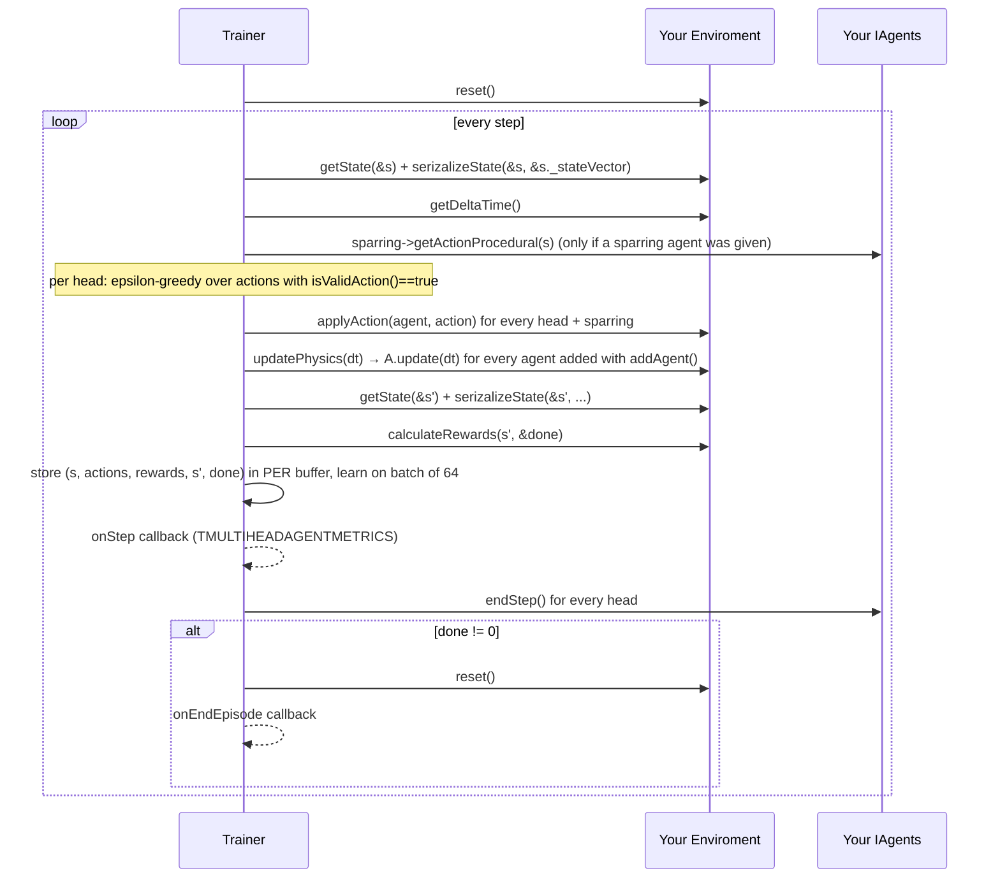

# Multi-Head Networks with Metis-Core — Developer Guide

> **Applies to:** Metis-Core v0.4.x (alpha) · C++17 · Windows / MSVC v143 · LibTorch backend (CPU or CUDA)
> **Reference examples:** `Examples/SwarmDefenseTIE` (escort mission) and `SARSwarm` (4-drone search & rescue)

This guide shows how to plug **your own simulation** into Metis-Core and train a **multi-head DQN**: one neural network, one shared input vector, and one output head per agent (or per decision branch). After reading it you should be able to build a new multi-head problem from scratch in an afternoon.

---

## Contents
1. [When to use a multi-head network](#1-when-to-use-a-multi-head-network)
2. [Mental model in 60 seconds](#2-mental-model-in-60-seconds)
3. [Quick start: the minimum code you must write](#3-quick-start-the-minimum-code-you-must-write)
4. [The training loop: exact call order](#4-the-training-loop-exact-call-order)
5. [Designing the state: `getState` vs `serizalizeState`](#5-designing-the-state-getstate-vs-serizalizestate)
6. [Designing actions and action masks](#6-designing-actions-and-action-masks)
7. [Designing rewards and terminal states](#7-designing-rewards-and-terminal-states)
8. [Training: callbacks, metrics, saving and resuming](#8-training-callbacks-metrics-saving-and-resuming)
9. [Inference: running the trained model](#9-inference-running-the-trained-model)
10. [Common pitfalls (read this before debugging)](#10-common-pitfalls-read-this-before-debugging)
11. [API reference](#11-api-reference)
12. [Case studies](#12-case-studies)
13. [Known limitations and roadmap](#13-known-limitations-and-roadmap)

---

## 1. When to use a multi-head network

Use it when **several decisions must be taken at the same time step**, and they depend on the same picture of the world:

| Situation | Heads | Why multi-head |
|---|---|---|
| Swarm of N drones / robots cooperating | one per agent | One network learns all the policies. No combinatorial explosion: N heads × A actions instead of A^N joint actions |
| One agent with independent sub-decisions | one per decision branch (e.g. direction, size, aggressiveness) | Each branch has its own action set and its own reward |
| Mixed roles (VIP + escorts) | one per role | Roles are separated by the agent ID and by action masks |

**Not a good fit:** agents that must decide with *strictly local* information (true decentralised execution). In Metis-Core every head sees the **same full input vector** (see §13).

---

## 2. Mental model in 60 seconds

```
                 your simulation (Enviroment + IAgent subclasses)
                                     │
       getState() ──► Metis::State (raw user struct, ≤ 1000 bytes)
                                     │
   serizalizeState() ──► std::vector<float>  (NUM_INPUTS, normalised)
                                     │
                     ┌───────────────┴───────────────┐
                     │   shared trunk (MultiHeadAgent) │
                     └───┬───────────┬───────────┬───┘
                      head "A"    head "B"    head "C"      one per addHead()
                      Q[0..n)     Q[0..n)     Q[0..n)       n = max actions
                         │           │           │
                  isValidAction() mask per agent → argmax → applyAction(agent, a)
                                     │
 calculateRewards() ──► std::vector<TMULTIHEAD>  (one reward per head, same order as addHead)
```

You write **two kinds of classes**:

| You derive from | You implement | Responsibility |
|---|---|---|
| `Metis::Enviroment` | `reset`, `getState`, `serizalizeState`, `applyAction`, `calculateRewards` (+ `calculateReward` empty) | The world, the observation, the rewards, the end of the episode |
| `Metis::IAgent` | `update`, and optionally `isValidAction`, `endStep`, `getActionProcedural` | One entity: its physics, its legal actions, its per-step flags |

Then you glue them together with `MultiHeadBrainBuilder` and `MultiHeadsAgentTrainerDQN`.

---

## 3. Quick start: the minimum code you must write

A complete skeleton: two agents that move on a grid. Replace the comments with your own logic.

### 3.1 Agent

```cpp
#include "METIS-Core.h"

enum ACTIONS { UP = 0, DOWN, LEFT, RIGHT, NUM_ACTIONS };

class MyEnv;

class MyAgent : public Metis::IAgent
{
public:
    float x = 0, y = 0;
    MyEnv* env = nullptr;

    explicit MyAgent(int id) { setID(id); }       // the ID identifies the agent and its role

    // physics of ONE step (called by Enviroment::updatePhysics for every agent)
    int update(double dt) override { /* move, update sensors... */ return 0; }

    // legal actions for this agent in the current state (default: all legal)
    bool isValidAction(int a) override { return a >= 0 && a < NUM_ACTIONS; }

    // reset per-step flags (e.g. "fired this step") — called at the end of every training step
    void endStep() override {}
};
```

### 3.2 Environment

```cpp
// raw state stored in the replay buffer: plain data, no pointers, < 1000 bytes
struct MyState
{
    float obs[2][4];   // already-computed observation of each agent
    int   step;
};
static_assert(sizeof(MyState) < MAX_SIZE_STATE, "MyState must fit in Metis::State");

constexpr int NUM_INPUTS = 2 * 4 + 1;

class MyEnv : public Metis::Enviroment
{
public:
    int step = 0;

    void reset() override { step = 0; /* place agents, randomise the scenario */ }

    void getState(Metis::State* pState) override
    {
        MyState s{};
        // fill s.obs from the CURRENT world (positions, sensors...)
        s.step = step;
        pState->copyState(&s, sizeof(MyState));        // copied into Metis-Core memory
    }

    void serizalizeState(void* state, std::vector<float>* v) override
    {
        auto* s = (MyState*)((Metis::State*)state)->getUserState();  // read ONLY the stored struct
        v->clear();
        for (auto& agentObs : s->obs)
            for (float f : agentObs) v->push_back(f);                // already normalised
        v->push_back((float)s->step / 1000.0f);                       // float division!
        assert((int)v->size() == NUM_INPUTS);
    }

    void applyAction(Metis::IAgent* agent, int action) override
    {
        auto* a = (MyAgent*)agent;
        // translate the action id into a command for this agent
    }

    float calculateReward(Metis::State&, int*) override { return 0.0f; }  // single-head DQN only

    std::vector<Metis::TMULTIHEAD> calculateRewards(Metis::State& state, int* pDone) override
    {
        auto* s = (MyState*)state.getUserState();
        step++;
        *pDone = 0;                                     // 0 running, 1 success, -1 failure

        Metis::TMULTIHEAD rA((char*)"AgentA"), rB((char*)"AgentB");   // names = addHead names
        rA.reward = /* dense shaping for A */ 0.0f;
        rB.reward = /* dense shaping for B */ 0.0f;

        if (/* goal reached */ false) { *pDone = 1;  rA.reward += 1; rB.reward += 1; }
        else if (step >= 1000)        { *pDone = -1; rA.reward -= 1; rB.reward -= 1; }

        return { rA, rB };                              // SAME ORDER as addHead()
    }

    float getDeltaTime() override { return 0.05f; }
};
```

### 3.3 Build the network and train

```cpp
MyAgent* a = new MyAgent(0);
MyAgent* b = new MyAgent(1);

bool gpu = Metis::isCUDAavailable();
Metis::MultiHeadBrainBuilder builder;
Metis::MultiHeadAgent* brain = builder.addHead("AgentA", a, NUM_ACTIONS)
                                      .addHead("AgentB", b, NUM_ACTIONS)
                                      .setNumberInputsOutputs(NUM_INPUTS)
                                      .useGPU(gpu)
                                      .build();

MyEnv* env = new MyEnv();
env->addAgent(a);          // every agent that must be simulated (heads AND non-learning ones)
env->addAgent(b);
for (MyAgent* ag : { a, b }) ag->env = env;
env->reset();

Metis::MultiHeadsAgentTrainerDQN trainer;
trainer.setCallbackPerStep(onStep);         // see §8
trainer.setCallbackEndEpisode(onEndEpisode);
trainer.training(env, brain /*, optionalSparringAgent */);   // blocks until stopped
```

That is the whole contract. Everything below explains how to do each part **well**.

---

## 4. The training loop: exact call order

`trainer.training(env, brain, sparring)` runs this loop until a callback sets `bForceStopTraining = true`:



**Consequences for your code**

* `calculateRewards()` receives the **next** state `s'`. Compute rewards from it and from facts produced during `update()` (collisions, detections...), never from stale data.
* World-level logic that must run **once per step after all agents moved** (e.g. collisions between agents, sensor fusion, communications) cannot live in a single `IAgent::update()`. Pattern used in SARSwarm: each `update()` sets a `dirty` flag on the environment, and `getState()` runs a `worldTick()` when the flag is set.
* `endStep()` is the place to clear per-step flags (`firedThisStep`, `decoyLaunched`...). It is called by the trainer, **not** in your own inference loop (see §9).

---

## 5. Designing the state: `getState` vs `serizalizeState`

They look redundant but have different jobs:

| | `getState(State*)` | `serizalizeState(void*, vector<float>*)` |
|---|---|---|
| Output | Your raw struct, copied with `copyState()` | The normalised float vector fed to the network |
| Stored in replay buffer | **Yes** (≤ 1000 bytes, `MAX_SIZE_STATE`) | The resulting `_stateVector` travels with the `State` |
| Reads the live world | Yes | **No** — only `getUserState()` |

### Rules

1. **Plain data only** in the user struct: no pointers, no `std::vector`, no virtual classes. It is copied with `memcpy`.
2. Add `static_assert(sizeof(MyState) < MAX_SIZE_STATE)`. Exceeding the limit throws at runtime.
3. **`serizalizeState` must read only the stored struct.** If it queries live objects (`getAgentFromID(...)->getPosition()`), a state replayed from the buffer would be rebuilt with *current* positions. Recommended pattern: compute the observation inside `getState()` and store it in the struct; `serizalizeState()` only copies and normalises.
4. **`clear()` the output vector** before `push_back`, and `assert(size == NUM_INPUTS)`.
5. **Normalise everything** to roughly [-1, 1]: positions / world size, velocities / max speed, angles as `cos`/`sin` (never raw degrees: 359° and 1° must be close).
6. Make the state **Markov** for the rewards: if a penalty grows with time (e.g. "seconds disconnected"), that time must be an input, or the network cannot predict it.

### Input layout for N agents

All heads receive the **same** vector. A layout that works well is one fixed-size block per agent, in the same order as `addHead`, followed by global features:

```
[ block agent 0 | block agent 1 | ... | block agent N-1 | global features ]
```

Head *i* learns to rely mostly on block *i*. Put inside each block what that agent knows: own pose, local sensor summary, relative position of teammates it can communicate with (zeros otherwise).

---

## 6. Designing actions and action masks

* `addHead(name, agent, maxActionsHead)` declares the head's action count. If agents have different action sets, use the **maximum** for every head and disable the extra ones with `isValidAction()`.
* `isValidAction(a)` is queried per agent, so it can depend on role **and** state (e.g. "no heading that leaves the map in the next 150 m").
* Always keep **at least one valid action** in every reachable state.
* Action ids for non-learning agents (sparring) may live **outside** the head range (e.g. `FIRE_MISSILE = 100`), so they never collide with network outputs. Handle them in `applyAction()`.
* Prefer actions that set a **target** (desired heading, waypoint) over raw controls (turn left 1°): they are easier to learn and the physics in `update()` smooths the motion.

---

## 7. Designing rewards and terminal states

### The return value

```cpp
std::vector<TMULTIHEAD> calculateRewards(State& sNext, int* pDone);
```

* One `TMULTIHEAD` per head, **in the same order as `addHead()`**, with the head name in the constructor.
* `*pDone`: `0` running · `1` success · `-1` failure. Set it to 0 at the beginning of the function.
* Decide `*pDone` **once**, at the end, with a clear priority (success > failure, or the other way round). Several independent `if` blocks writing `*pDone` can turn a success into a failure.

### Guidelines

| Guideline | Why |
|---|---|
| Keep per-step (shaping) rewards in a fixed range, e.g. [-1, 1], and put big terminal bonuses on top | Stable Q-values, terminal events still dominate |
| Normalise with a **fixed** divisor (sum of weights), not a dynamic one | Otherwise the same behaviour gets different rewards |
| Clamp **after** adding all penalties, and check that the clamp does not hide them | A drone at 900 m and at 1150 m (warning zone) got the same 4.0 because of an early clamp |
| No shared mutable counters between heads | Two heads incrementing the same "window" counter penalise each other |
| Integer division bug: `step / MAX_STEPS` with ints is 0 | Use `(float)step / MAX_STEPS` |
| Cooperative tasks: measure each agent's contribution against the **team** state | Example: exploration credited only for cells the team had not seen; repeating a teammate's work yields 0 |
| If the team must stay together, make *any* split strictly worse than staying together, and growing with time | Otherwise the network learns that splitting up pays |

**Verify numerically before training.** Run a headless harness with scripted policies (random, heuristic, "everyone isolated"...) and print the mean reward per head. If the *bad* behaviour earns as much as the *good* one, the network will learn the bad one.

---

## 8. Training: callbacks, metrics, saving and resuming

```cpp
void onStep(void* sender, Metis::TMULTIHEADAGENTMETRICS* m)
{
    float rA = m->_headMetric["AgentA"].reward;      // last reward of each head, by name
    m->bForceStopTraining = g_userPressedStop;       // the ONLY way to stop training()
    if (m->step % 25 == 0) render();                 // keep the UI alive without slowing training
}

void onEndEpisode(void* sender, Metis::TMULTIHEADAGENTMETRICS* m)
{
    if (m->episode % METRICS_X_EPISODES != 0) return;      // METRICS_X_EPISODES = 50
    // m->countSuccesX50episodes, m->_meanTotalLoss, m->_headMetric[name]._meanLossHead / _meanGradient
    if (m->countSuccesX50episodes > g_best) { g_best = m->countSuccesX50episodes; brain->saveIAModel((char*)"model.ai"); }
}
```

| Field of `TMULTIHEADAGENTMETRICS` | Meaning |
|---|---|
| `episode`, `step` | Counters |
| `_headMetric[name].reward` | Reward of that head in the last step |
| `_headMetric[name]._meanLossHead`, `_meanGradient` | Learning diagnostics per head |
| `_meanTotalLoss`, `_gradient_norm`, `_backbone_norm` | Global diagnostics |
| `countSuccesX50episodes` | Episodes with `done == 1` in the last 50 |
| `bForceStopTraining` | Set to `true` to leave `training()` |

**Resuming training.** `MultiHeadAgent` keeps its weights in memory after `training()` returns, so calling `training()` again in the same process continues from them. After restarting the program, call `brain->loadIAModel(file, gpu)` **before** `training()`. The replay buffer is not saved and starts empty. *(TODO: document whether epsilon and the target network are re-initialised.)*

**A model only fits the network that produced it:** same number of inputs, heads and actions. Changing `NUM_INPUTS` invalidates every saved `.ai` file.

---

## 9. Inference: running the trained model

```cpp
brain->loadIAModel((char*)"model.ai", gpu);

// one simulation step
Metis::State s;
env->getState(&s);
env->serizalizeState(&s, &s._stateVector);

int aA = brain->getBestAction(agentA, s);    // greedy, per head
int aB = brain->getBestAction(agentB, s);
env->applyAction(agentA, aA);
env->applyAction(agentB, aB);
env->applyAction(sparring, sparring->getActionProcedural(s));   // or human input

env->updatePhysics(env->getDeltaTime());

// replicate what the trainer does, or behaviour will differ from training:
Metis::State sNext;
env->getState(&sNext);
int done = 0;
env->calculateRewards(sNext, &done);         // also detects the end of the episode
agentA->endStep();                           // per-step flags MUST be cleared here too
agentB->endStep();
if (done != 0) env->reset();
```

The most frequent "it trained well but plays badly" bug is an inference loop that does not reproduce the training loop (missing `endStep()`, different `dt`, rewards/world tick never called).

---

## 10. Common pitfalls (read this before debugging)

| Symptom | Likely cause | Fix |
|---|---|---|
| Exception "size of the State is too much" | User struct ≥ 1000 bytes | Store compact data, `static_assert` |
| Assert on input size | `serizalizeState` appends to a non-empty vector, or a branch pushes a different number of values | `clear()` first, push placeholders (0) for missing data |
| An input is always 0 | Integer division | Cast to `float` |
| Replay seems to learn nonsense | `serizalizeState` reads the live world | Read only `getUserState()` |
| Success episodes counted as failures | `*pDone` overwritten by a later `if` | Decide `done` once, with priorities |
| Two heads behave strangely together | Shared counters/flags in reward code | One counter per agent |
| Penalties have no effect | Clamp applied before penalties, or reward dominated by another term | Clamp last; print each term |
| Agents learn to split up / idle | Bad behaviour pays as much as good behaviour | Headless numeric test of the reward |
| Plays worse than in training | Inference loop differs (no `endStep`, no world tick, other `dt`) | Mirror §4 in the play loop |
| Override "does nothing" | Signature mismatch with the base virtual | Always write `override` |
| Agent never moves in training | Agent not added with `env->addAgent()` | Add every simulated agent, learning or not |

---

## 11. API reference

### `Metis::Enviroment` (derive)
| Method | Required | Notes |
|---|---|---|
| `void reset()` | yes | Start of every episode; randomise the scenario |
| `void getState(State*)` | yes | Fill your struct, `copyState(&s, sizeof s)` |
| `void serizalizeState(void* state, std::vector<float>*)` | yes | Normalised input vector, size = `setNumberInputsOutputs` value |
| `void applyAction(IAgent*, int)` | yes | Called for every head and for the sparring agent |
| `std::vector<TMULTIHEAD> calculateRewards(State&, int* done)` | yes (multi-head) | One reward per head, `addHead` order |
| `float calculateReward(State&, int*)` | yes (pure virtual) | Return 0 in multi-head projects |
| `float getDeltaTime()` | optional | Simulation `dt` |
| `addAgent`, `getAgentFromID`, `getAgents`, `getNumberAgents`, `updatePhysics(dt)` | provided | `updatePhysics` calls `update(dt)` on every added agent |

### `Metis::IAgent` (derive)
| Method | Default | Use it for |
|---|---|---|
| `int update(double dt)` | — | Physics and sensors of the agent |
| `bool isValidAction(int)` | `true` | Role/state action mask |
| `void endStep()` | empty | Clear per-step flags |
| `int getActionProcedural(State&)` | — | Rule-based sparring opponent or baseline heuristic |
| `setID / getID` | — | Agent identity and role |

### `Metis::MultiHeadBrainBuilder`
| Method | Notes |
|---|---|
| `addHead(std::string name, IAgent* agent, int maxActions)` | Name used in rewards and metrics; order matters |
| `setNumberInputsOutputs(int numInputs)` | Must equal the size produced by `serizalizeState` |
| `useGPU(bool)` | Use `Metis::isCUDAavailable()` |
| `addValueHead(std::string)` | *(TODO: document — used by AlphaZero-style trainers)* |
| `MultiHeadAgent* build()` | Creates the network |

### `Metis::MultiHeadAgent`
| Method | Notes |
|---|---|
| `int getBestAction(IAgent* agent, State& s)` | Greedy action of that agent's head; `s._stateVector` must be filled |
| `void saveIAModel(char* file)` / `int loadIAModel(char* file, bool gpu)` | Model persistence |

### `Metis::MultiHeadsAgentTrainerDQN`
| Method | Notes |
|---|---|
| `void training(Enviroment*, MultiHeadAgent*, IAgent* sparring = NULL)` | Blocking loop of §4. DQN + Prioritized Experience Replay, batch 64 |
| `setCallbackPerStep(fn)`, `setCallbackEndEpisode(fn)` | `void fn(void* sender, TMULTIHEADAGENTMETRICS*)` |

---

## 12. Case studies

### SwarmDefenseTIE — roles and event rewards
Shuttle + 2 TIE escorts (3 heads) against a procedural X-Wing (sparring agent). Shows:
* **Roles by ID** with a single `Spacecraft` class and `isValidAction` (the shuttle cannot fire, escorts cannot launch decoys).
* **Dense shaping** (formation, heading) mixed with **event rewards** (laser at the right moment, decoy against an incoming missile).
* A sparring agent whose actions (`FIRE_MISSILE`) are outside the head action range.

### SARSwarm — cooperation and communications
4 drones (4 heads) launched from a ship search a drifting castaway. Shows:
* A per-agent observation block (sector summary of each drone's own heat map, teammates visible only through the radio mesh).
* `worldTick()` pattern for once-per-step world logic (sensor fusion, mesh components, detection).
* **Cooperative reward**: exploration measured on the team map (redundant scanning pays 0), a penalty that grows with the time out of the mesh, and a numeric proof that any split earns less than staying connected.
* Evaluation against a classical **lawnmower** search baseline simulated in the same environment.

---

## 13. Known limitations and roadmap

* **Shared input for all heads.** Every head sees the full vector, so an isolated agent's head still sees the other agents' blocks. Fine for centralised control and proofs of concept; not a true decentralised policy. Roadmap: per-agent inputs (VDN / QMIX-style training).
* Batch size fixed at 64.
* `serializeState` is spelled `serizalizeState` in the API.
* `getState` / `serizalizeState` may be merged in a future version.
* `isEpisodeDone()` and `setNumActions()` are unused in multi-head projects.