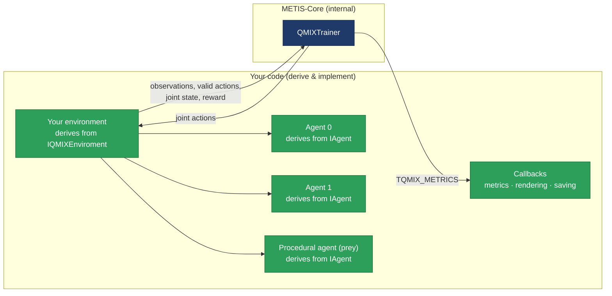
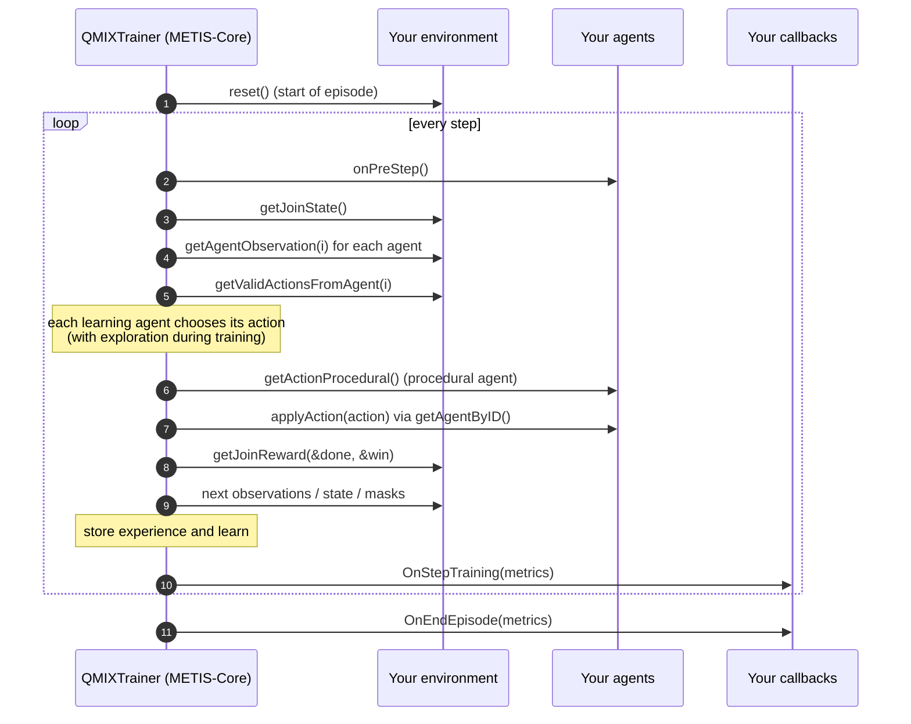
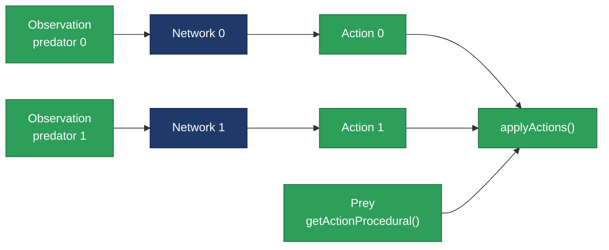

# Tutorial: Cooperative Multi-Agent Learning with QMIX in METIS-Core

### Example: `PredatorPreyQMIX`

This tutorial shows how to use the **QMIX** functionality of METIS-Core through the
`PredatorPreyQMIX` example. Two predators (drones) must learn to **cooperate** to capture a
prey on a 7×7 grid. A capture only succeeds when **both** predators try to capture at the
same time. If only one tries, the team is penalized.

You will learn:

1. What QMIX does and why it fits cooperative problems.
2. Which METIS-Core classes you derive from and which methods you implement.
3. How to train, save, load and run the trained team.
4. Common pitfalls and how to avoid them.

> **Audience:** C++ programmers who know the basics of reinforcement learning (state, action,
> reward, episode). You do not need to know LibTorch: METIS-Core hides it.
>
> This tutorial covers only the **public API** of METIS-Core (v0.5.x). Everything the framework
> does internally (networks, mixing, replay, optimization) is handled for you.

### QMIX or multi-head?

METIS-Core offers two ways to train cooperating agents. Pick the one that fits your problem:

| | Multi-head DQN (see the SARSwarm tutorial) | QMIX (this tutorial) |
|---|---|---|
| Networks | One shared network, one head per agent | One network per agent |
| Rewards | One reward **per agent** | One **team** reward |
| Input at execution | The full input vector | Each agent's **own observation** only |
| Best for | Agents with individual goals that share a world | Agents that win or lose **together** and only see part of the world |

## Table of contents
1. [QMIX in one minute](#1-qmix-in-one-minute)
2. [The example at a glance](#2-the-example-at-a-glance)
3. [The METIS-Core API you will use](#3-the-metis-core-api-you-will-use)
4. [Step by step](#4-step-by-step)
5. [Pitfalls and how to avoid them](#5-pitfalls-and-how-to-avoid-them)
6. [Checking rewards and evaluating the policy](#6-checking-rewards-and-evaluating-the-policy)
7. [Checklist for a new QMIX project](#7-checklist-for-a-new-qmix-project)
8. [Going further](#8-going-further)

---

## 1. QMIX in one minute

QMIX follows the **Centralized Training, Decentralized Execution (CTDE)** paradigm:

- **During training**, METIS-Core can use the **joint state** of the whole environment
  (positions of every agent and of the prey) to learn how the team's actions combine
  into a single team value.
- **During execution**, each agent decides **alone**, using only **its own observation**
  (what it can see around itself).

The key property is *monotonicity*: improving the value of one agent's action never
lowers the team value. That is why each agent can simply pick its own best action at
execution time and the team still behaves coherently.



**Green** is what you write. **Navy** is what METIS-Core provides.

---

## 2. The example at a glance

| Element | Value |
|---|---|
| Grid | 7 × 7 |
| Learning agents | 2 predators |
| Procedural agent | 1 prey (random moves, not learned) |
| Predator actions | `UP, DOWN, LEFT, RIGHT, STAY, CAPTURE` (6) |
| Observation per predator | 8 floats (own position, teammate if visible, prey if visible) |
| Vision | Square window of radius 2 around each predator |
| Joint state | 7 floats (both predators, prey, episode progress) |
| Rewards | `-0.1` per step, `+10` joint capture, `-0.5` solo capture attempt |
| Episode limit | 80 steps |

Project files:

```
PredatorPreyQMIX/
├── Kernel/
│   ├── predator.h / .cpp        // learning agent     (derives from Metis::IAgent)
│   ├── prey.h / .cpp            // procedural agent   (derives from Metis::IAgent)
│   └── predatorPrayEnv.h / .cpp // environment        (derives from Metis::IQMIXEnviroment)
├── PredatorPreyRenderer.h / .cpp // raylib visualization (optional)
└── main.cpp                      // training / play entry point
```

---

## 3. The METIS-Core API you will use

Everything is in the `Metis` namespace and available through `#include "METIS-Core.h"`.

### 3.1 `Metis::IQMIXEnviroment`: your environment

You derive from it and implement these pure virtual methods:

| Method | What you must return |
|---|---|
| `void reset()` | Put the world in its initial state at the start of each episode. |
| `int getNumberOfAgents()` | Number of **learning** agents (2 here). |
| `int getAgentInputSize()` | Size of one agent's observation vector. |
| `int getAgentActionsSize()` | Number of discrete actions per agent. |
| `int getJoinStateSize()` | Size of the joint (global) state vector. |
| `IAgent* getAgentByIndex(int index)` | Learning agent number `index` (0…N-1). |
| `IAgent* getAgentByID(int id)` | Any agent by its ID, **including the procedural agent**. |
| `void getAgentObservation(int index, std::vector<float>* obs)` | What agent `index` can see. |
| `std::vector<int> getValidActionsFromAgent(int index)` | Action mask: `1` = valid, `0` = invalid. |
| `void getJoinState(std::vector<float>* state)` | Global state (used only during training). |
| `double getJoinReward(bool* pDone, bool* pWin)` | Team reward for the step, and whether the episode ended or was won. |

And you use these helpers in your constructor:

| Method | Purpose |
|---|---|
| `addAgent(IAgent*)` | Register a learning agent. |
| `setProceduralAgent(IAgent*)` | Register a non-learning agent (scripted behavior). |
| `applyActions(std::map<int,int>)` | Apply a joint action `{agentID → action}` (used in play mode). |

Public counters: `_episode` and `_step`.

### 3.2 `Metis::IAgent`: your agents

| Method | Who uses it | Purpose |
|---|---|---|
| `setID(int)` / `getID()` | both | Unique agent identifier. |
| `createBrain(int inputs, int actions)` | learning agent | Creates the agent's network. |
| `createTargetBrain()` | learning agent | Creates its target network (required by QMIX). |
| `virtual void onPreStep()` | learning agent | Called before every step; reset per-step flags here. |
| `virtual void applyAction(int action)` | both | Execute the chosen action in the world. |
| `virtual int getActionProcedural()` | procedural agent | Return the scripted action. |
| `int selectActionQmix(obs, index, validActions)` | play mode | Pick the agent's action from its own observation. |
| `void setPlayMode()` | play mode | Disable exploration (pure learned policy). |
| `saveIAModel(char*)` / `loadIAModel(char*)` | both | Save / load the trained network. |

### 3.3 `Metis::QMIXTrainer`: the training loop

| Method | Purpose |
|---|---|
| `setCallbackPerStep(OnStepTraining)` | Called after each environment step. |
| `setCallbackEndEpisode(OnEndEpisode)` | Called at the end of each episode. |
| `training(IQMIXEnviroment* env, bool bUseCUDA)` | Runs the whole training. |

Both callbacks receive a `Metis::TQMIX_METRICS*`:

| Field | Meaning |
|---|---|
| `episode`, `step` | Current episode and step. |
| `globalReward` | Team reward. |
| `epsilon` | Current exploration rate. |
| `loss` | Current training loss. |
| `bIsDone`, `bWin` | Episode finished / episode won. |
| `bForceStopTraining` | Set it to `true` to stop training. |

`Metis::isCUDAavailable()` tells you whether a GPU can be used.

---

## 4. Step by step

### Step 1: Define the actions

```cpp
enum class PredatorAction : int
{
    UP = 0, DOWN = 1, LEFT = 2, RIGHT = 3,
    STAY = 4,
    CAPTURE = 5,   // only valid if the prey is adjacent
    COUNT
};
constexpr int N_ACTIONS = static_cast<int>(PredatorAction::COUNT);   // 6
```

The prey has its own action set (no `CAPTURE`). It is never learned, so it does not need
to match the predators' action count.

### Step 2: The learning agent

Derive from `Metis::IAgent`, create its two networks **once** in the constructor, and
implement `onPreStep()` and `applyAction()`.

```cpp
class predator : public Metis::IAgent
{
    Metis::Vector2D _pos;
public:
    int _tryCaptured = 0;          // capture intent for this step
    predatorPrayEnv* _pEnv;

    predator()
    {
        createBrain(AGENT_INPUT_SIZE, N_ACTIONS);   // online network
        createTargetBrain();                        // target network (same shape)
    }

    void onPreStep() override { _tryCaptured = 0; } // clear per-step flags

    void applyAction(int action) override
    {
        switch ((PredatorAction)action)
        {
        case PredatorAction::UP:    if (_pos.y > 0) _pos.y--; break;
        case PredatorAction::DOWN:  if (_pos.y < SIZE_WORD - 1) _pos.y++; break;
        case PredatorAction::LEFT:  if (_pos.x > 0) _pos.x--; break;
        case PredatorAction::RIGHT: if (_pos.x < SIZE_WORD - 1) _pos.x++; break;
        case PredatorAction::STAY:  break;
        case PredatorAction::CAPTURE:
            // only record the intent; the environment resolves it in getJoinReward()
            if (manhattan(_pos, _pEnv->getPreyPos()) == 1) _tryCaptured++;
            break;
        }
    }
};
```

**Design tip:** `CAPTURE` does not capture directly. It only records an *intent*. The
environment then decides, with all intents known, whether the capture succeeds. This is
what makes the problem truly cooperative.

### Step 3: The procedural agent

Agents that should not learn (the prey, an obstacle, a scripted enemy…) also derive from
`IAgent`, but implement `getActionProcedural()` instead of creating a brain.

```cpp
int prey::getActionProcedural()
{
    // immobilized when two predators are adjacent
    if (countAdjacentPredators() >= 2) return (int)PreyAction::STAY;

    while (true)   // random valid move (rejection sampling keeps it uniform)
    {
        int a = (int)(_rng() % (int)PreyAction::COUNT);
        if (a == (int)PreyAction::STAY) return a;
        if (isInsideAndFree(_pos, a)) return a;
    }
}
```

Use your own `std::mt19937` with a fixed seed: it gives the same sequence on every
compiler, which makes experiments reproducible.

### Step 4: The environment

#### 4.1 Register the agents

```cpp
predatorPrayEnv::predatorPrayEnv()
{
    _predators[0].setID(0);
    _predators[1].setID(1);
    _prey.setID(2);

    addAgent(&_predators[0]);      // learning agents
    addAgent(&_predators[1]);
    setProceduralAgent(&_prey);    // scripted agent

    _predators[0]._pEnv = _predators[1]._pEnv = _prey._pEnv = this;
}
```

`getAgentByID()` must also return the procedural agent. Otherwise its action is silently
ignored:

```cpp
Metis::IAgent* predatorPrayEnv::getAgentByID(int id)
{
    for (auto& p : _predators) if (p.getID() == id) return &p;
    if (_prey.getID() == id) return &_prey;
    return nullptr;
}
```

#### 4.2 Observation vs. joint state

This is the core of QMIX, so take care here.

| | `getAgentObservation()` | `getJoinState()` |
|---|---|---|
| Who sees it | One agent | Only the trainer |
| When | Training **and** execution | Training only |
| Content here | Own position, teammate and prey **only if in sight** | Every position + episode progress |

```cpp
void predatorPrayEnv::getAgentObservation(int i, std::vector<float>* obs)
{
    const float norm = (float)(SIZE_WORD - 1);          // positions to [0,1]
    obs->clear();
    Metis::Vector2D me = getPredatorPos(i);
    obs->push_back(me.x / norm);
    obs->push_back(me.y / norm);

    // teammate: flag + position (zeros when not visible)
    // prey:     flag + position (zeros when not visible)
    // ... see predatorPrayEnv.cpp
}

void predatorPrayEnv::getJoinState(std::vector<float>* s)
{
    const float norm = (float)(SIZE_WORD - 1);
    s->clear();
    for (int i = 0; i < MAX_PREDATORS; i++)
    {
        s->push_back(getPredatorPos(i).x / norm);
        s->push_back(getPredatorPos(i).y / norm);
    }
    s->push_back(getPreyPos().x / norm);
    s->push_back(getPreyPos().y / norm);
    s->push_back((float)_step / (float)MAX_STEPS);   // episode progress
}
```

Always normalize values to a similar range (here `[0,1]`), and make sure the vector sizes
match `getAgentInputSize()` and `getJoinStateSize()`.

#### 4.3 The valid-action mask

Return a vector of size `getAgentActionsSize()` with `1` for valid actions and `0`
otherwise. METIS-Core never selects or bootstraps from an invalid action.

```cpp
std::vector<int> predatorPrayEnv::getValidActionsFromAgent(int i)
{
    std::vector<int> valid(N_ACTIONS, 0);
    // moves: inside the map and not onto the prey
    // STAY:  always valid  -> guarantees at least one action
    valid[(int)PredatorAction::STAY] = 1;
    // CAPTURE: only when the prey is adjacent
    valid[(int)PredatorAction::CAPTURE] = (manhattan(me, prey) == 1);
    return valid;
}
```

The mask is a **mask**, not a list of action indices: `{1,1,1,0,1,1}` means "every action
except 3".

#### 4.4 The team reward

QMIX optimizes **one shared reward** for the whole team. Resolve the joint outcome here:

```cpp
double predatorPrayEnv::getJoinReward(bool* pDone, bool* pWin)
{
    double reward = STEP_PENALTY;                 // -0.1: hurry up
    *pDone = false;  *pWin = false;

    int nCapturing = countPredatorsTryingToCapture();
    if (nCapturing >= 2)                          // cooperative capture
    {
        reward += CAPTURE_REWARD;                 // +10
        *pDone = true;  *pWin = true;
    }
    else if (nCapturing == 1)                     // solo attempt
    {
        reward += SOLO_CAPTURE_PENALTY;           // -0.5
    }

    if (_step > MAX_STEPS) *pDone = true;         // time limit
    return reward;
}
```

The penalty for a solo attempt is what forces cooperation. Without it, a single predator
would keep trying to capture alone.

### Step 5: One training step, as seen by your code

You do not write the training loop. This is the order in which `QMIXTrainer` calls your
methods during each step:



Key consequences of this contract:

- **`applyAction()` runs before `getJoinReward()`.** Actions whose effect depends on what the
  *other* agents did (like a joint capture) should only record an *intent* in `applyAction()`
  and be **resolved in `getJoinReward()`**, when every action of the step is known.
- **`onPreStep()` is the place to clear per-step flags.** If you forget it, an intent from the
  previous step leaks into the current one.
- **After the reward, the trainer reads the world again** (next observations, next joint state,
  next masks). Make sure these methods always read the **current** world, and that the world
  is already updated when `getJoinReward()` returns.
- **The procedural agent acts in the same step.** In this example the prey moves after the
  predators. Think about the order that makes sense in your world. Here, a prey surrounded by
  two predators is immobilized, so a correct joint capture cannot fail because the prey left.
- **`getAgentByIndex(i)` and `getAgentObservation(i, …)` use the same index `i`.** Index `i`
  is the position of the learning agent (0…N-1), while `getAgentByID()` uses the agent's ID.
  In this example both coincide for the predators, but keep them consistent in your project.

### Step 6: Train

```cpp
predatorPrayEnv gEnv;

void OnStepTraining_cb(void* pSender, Metis::TQMIX_METRICS* m)
{
    // e.g. draw the grid
}

void OnEndTraining_cb(void* pSender, Metis::TQMIX_METRICS* m)
{
    // e.g. success rate over the last 50 episodes, logging, saving the best model:
    if (isNewBest(m))
        for (int i = 0; i < MAX_PREDATORS; i++)
        {
            char name[64];
            sprintf(name, "predator_%d.ia", i);
            gEnv._predators[i].saveIAModel(name);
        }
}

int main()
{
    Metis::QMIXTrainer trainer;
    trainer.setCallbackPerStep(OnStepTraining_cb);
    trainer.setCallbackEndEpisode(OnEndTraining_cb);
    trainer.training(&gEnv, Metis::isCUDAavailable());
}
```

Save **each learning agent** to its own file. In QMIX every agent has its own network,
and only those networks are needed at execution time.

More about training:

- **Stopping gracefully:** set `m->bForceStopTraining = true` in a callback (for example when
  the success rate stays at 100 % for a while, or when the window is closed).
- **GPU:** pass `Metis::isCUDAavailable()` as `bUseCUDA`. For small networks like this one the
  CPU may be just as fast; measure both.
- **Rendering is slow:** drawing every step can dominate the training time. Draw every N steps
  or every N episodes, and keep the window responsive with a time-based redraw.
- **Reproducibility:** use fixed seeds in your own random generators (`std::mt19937`), so the
  same run gives the same results.
- **Save the best model, not only the last one.** A success rate over a sliding window
  (e.g. the last 50 episodes, using `m->bWin`) is a simple and robust criterion.

### Step 7: Play (decentralized execution)

At execution time there is no trainer and no joint state: each predator decides from its
own observation.

```cpp
// load each predator's network and disable exploration
for (int i = 0; i < MAX_PREDATORS; i++)
{
    char name[64];
    sprintf(name, "predator_%d.ia", i);
    gEnv._predators[i].loadIAModel(name);
    gEnv._predators[i].setPlayMode();
}

gEnv.reset();
bool done = false, win = false;
while (!done)
{
    gEnv._step++;
    for (auto& p : gEnv._predators) p.onPreStep();

    std::map<int, int> jointActions;
    for (int i = 0; i < MAX_PREDATORS; i++)
    {
        std::vector<float> obs;
        gEnv.getAgentObservation(i, &obs);                 // ONLY its own observation
        std::vector<int> valid = gEnv.getValidActionsFromAgent(i);
        jointActions[gEnv._predators[i].getID()] =
            gEnv._predators[i].selectActionQmix(obs, i, valid);
    }
    jointActions[gEnv._prey.getID()] = gEnv._prey.getActionProcedural();

    gEnv.applyActions(jointActions);
    gEnv.getJoinReward(&done, &win);
}
```



---

## 5. Pitfalls and how to avoid them

| Symptom | Likely cause | Fix |
|---|---|---|
| The procedural agent never moves | `getAgentByID()` does not return it | Return every agent, including the procedural one. |
| Capture never succeeds | `onPreStep()` does not clear the per-step flag, or `CAPTURE` never sets it | Clear flags in `onPreStep()`, set them in `applyAction()`. |
| Agents choose impossible actions | The mask is built as a list of indices | Return a 0/1 vector of size `getAgentActionsSize()`. |
| Runtime size errors | Observation or state size differs from what you declared | Keep `getAgentInputSize()` / `getJoinStateSize()` in sync with the vectors. |
| Trained well, but agents freeze in play mode | An observation that never changes (e.g. all zeros when nothing is in sight) makes a greedy agent repeat the same action forever | Make observations informative even when nothing is visible (e.g. add episode progress or a last-known position), or widen the vision range. |
| Play results differ from training | Model loaded into a different object, or saved too early | Load after constructing the environment; save the best model periodically. |
| Training never ends | `getJoinReward()` never sets `*pDone` | Always end the episode on success **and** on a step limit. |
| `loadIAModel()` fails or the agent behaves randomly | Observation size or action count changed after saving | Any change to `getAgentInputSize()` or `getAgentActionsSize()` invalidates saved models: retrain. |
| The reward seems impossible to learn | The reward depends on something the agents cannot observe | Every reward term should be explainable from the observations (and, during training, from the joint state). |
| Learning agents need different action counts | QMIX uses one action count for every learning agent | Use the largest count in `getAgentActionsSize()` and mask the extra actions with `0`. |

---

## 6. Checking rewards and evaluating the policy

**Check the rewards with numbers before training.** Before spending hours of training, play a
few scripted policies in your own environment and compute their average return:

| Scripted policy | What you expect |
|---|---|
| Random predators | Low return, rare captures, many solo penalties |
| Greedy predators that walk towards the prey and capture alone | Penalties: return should be **worse** than cooperating |
| Scripted "both approach, then capture together" | The **highest** return |

If the behavior you want does not get the highest return, fix the reward first. No algorithm
can learn what the reward does not pay for.

**Evaluate the learned policy in play mode, not only with the training curve.** The training
curve includes exploration. Measure in play mode, with `setPlayMode()`:

- **Capture rate** over a number of episodes.
- **Mean steps to capture.**
- **Number of solo attempts** (lack of coordination).

Compare these numbers with the scripted policies above. A good QMIX team should beat random and
"greedy solo" predators clearly, and get close to the scripted cooperative policy.

---

## 7. Checklist for a new QMIX project

1. Write the constants in one place: grid or world size, number of agents, actions,
   observation size, joint-state size, rewards, step limit.
2. One `IAgent` subclass per kind of learning agent: `createBrain()` + `createTargetBrain()`
   **once** in the constructor, `onPreStep()`, `applyAction()`.
3. Optional procedural agents: `IAgent` subclass with `getActionProcedural()` and
   `applyAction()`.
4. One `IQMIXEnviroment` subclass: register agents with `addAgent()` /
   `setProceduralAgent()`, and implement the 11 pure virtual methods.
5. Observations: normalized, the same size every step, informative even when nothing is
   visible.
6. Joint state: everything the team reward depends on.
7. Masks: 0/1 vectors with at least one valid action.
8. Team reward: resolve joint actions in `getJoinReward()`, end the episode on success and on
   a step limit.
9. Verify the rewards numerically with scripted policies.
10. Train with callbacks: log, save the best model, allow a graceful stop.
11. Play mode: `loadIAModel()` + `setPlayMode()` + `selectActionQmix()` with each agent's own
    observation, and compare against the scripted baselines.

---

## 8. Going further

- **More agents:** increase `MAX_PREDATORS` and require more simultaneous captures.
- **Smarter prey:** make `getActionProcedural()` flee from the closest predator.
- **Larger worlds:** grow the grid and the vision window, and watch how cooperation emerges.
- **Your own problem:** any task with several agents, a **shared goal** and **partial
  observation** (search and rescue, area coverage, escort, traffic coordination) fits this
  same template: one environment, N learning agents, optional procedural agents, one team
  reward.

---

*METIS-Core: you define the world, the agents and the rewards; METIS-Core learns how the
team should cooperate.*
